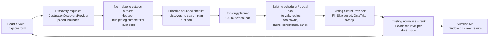

# 02 — System Architecture and Runtime Boundaries

## Approved stack and rationale

- Backend: **Python 3.12+**, **FastAPI**, Pydantic v2, Uvicorn, `httpx`, official Python MCP client SDK if compatible, SQLite, SQLAlchemy 2, Alembic; `pytest`, pytest-asyncio, Ruff, static typing.
- Web: **React + TypeScript + Vite**, accessible responsive CSS. Consume OpenAPI schema or generated TS types; no browser-side provider secrets/requests.
- iOS: **SwiftUI + URLSession**, genuinely native UI, structured concurrency, native date selection, same backend contract.
- Blocking providers (e.g., `swoop`) isolated in a **bounded** executor / `asyncio.to_thread` with concurrency, timeout and cancellation semantics documented; avoid freezing event loop.
- SQLite + one dedicated scheduler owner for personal deployment. No Redis, Celery, Kafka, Rust services, or microservices before measured need.

**Why Python:** external APIs, throttling and fare semantics are bottlenecks; adding Rust would increase integration friction without improving prices. Do not reopen this decision absent concrete evidence.

## Ownership diagram

```text
apps/web ──────────────────────┐
                              ├── REST /api/v1 ─── backend/api
apps/ios (SwiftUI) ────────────┘                        │
                                            application/search_service
                                                      │
               ┌──────────────────────────────────────┼──────────────────────┐
               ▼                                      ▼                      ▼
      scheduler + coverage                   canonical domain          SQLite repositories
               │                        (money, itinerary, fare)       and migrations
       provider adapter registry                      │
         ├─ Skiplagged MCP                            ▼
         ├─ swoop                          matcher → aggregator → ranker
         └─ future third-party                      ↑
                                         pricing/repricing service
```

### Dependency rule

`api -> application -> domain`; provider adapters and repositories implement `domain/application` interfaces. **Domain never imports HTTP, MCP, FastAPI, SQLAlchemy, swoop, React or SwiftUI.** `api` and app clients never interpret raw source payloads.

## Proposed repository layout

```text
cheapwings/
  README.md
  docs/                                 # copied worker handoff + implementation ADRs
  contracts/openapi.yaml
  contracts/fixtures/{provider,canonical}/
  contracts/fixtures/core/core_fixtures.json  # generated from Python; gates Rust, PyO3 and Swift
  core/                                 # shared Rust engine (P5.1), see docs/log/p5.1.md
    cheapwings-core/                    # pure logic: money, fingerprint, ranking, Fli decoder
    cheapwings-py/                      # PyO3 module `cheapwings_core` used by domain/money.py
    cheapwings-ffi/                     # UniFFI; the only Rust library linked into the iPad app
    build-ios.sh                        # XCFramework + Swift bindings → apps/ios/CheapWingsCore
  backend/
    pyproject.toml
    alembic.ini
    migrations/
    src/cheapwings/
      api/{routes,schemas,errors}.py
      application/{search_service,job_runner,verification_service}.py
      domain/{query,money,segments,itinerary,offer,coverage,ranking}.py
      providers/{base,registry,skiplagged,swoop,fake}.py
      engine/{expansion,rate_limiter,scheduler,normalization,aggregation,matching}.py
      storage/{db,models,repositories}.py
      config.py
      main.py
    tests/{unit,integration,fixtures,live_canary}/
  apps/
    web/{src,package.json}
    ios/                                  # Xcode project + SwiftUI sources (P5.2)
      CheapWingsCore/                     # Swift package over the shared Rust core (P5.1)
      CheapWingsKit/                      # URLSession Fli transport + paced SearchEngine (P5.2)
      CheapWings/                         # SwiftUI iPad app, XcodeGen project.yml (P5.2)
  scripts/                              # local dev, canary, fixture refresh helpers
  .env.example
```

## Provider abstraction contract

Keep these concerns distinct:

```python
from dataclasses import dataclass
from typing import Protocol

@dataclass(frozen=True)
class ProviderCapabilities:
    detailed_search: bool
    calendar: bool
    exact_reprice: bool
    has_booking_link: bool
    has_hidden_city_flag: bool
    has_baggage_details: bool

class FlightProvider(Protocol):
    provider_id: str
    capabilities: ProviderCapabilities

    async def search(self, query: 'SingleDateRouteQuery') -> 'ProviderSearchResult': ...
    async def get_calendar(self, query: 'CalendarQuery') -> 'ProviderCalendarResult': ...
    async def reprice(self, quote: 'ProviderQuoteHandle') -> 'ProviderRepriceResult': ...
```

**Important:** optional capability methods should produce a typed `UnsupportedCapability` result or be separate protocols. Do not make adapters pretend to support a calendar or repricing operation. The orchestration path must branch by advertised capability, not by specific provider name.

Every provider result contains `provider_id`, `requested_pair`, source timestamp if known, retrieval timestamp, result limit/completeness signal, raw evidence handle, returned candidates, and normalized errors. Adapter owns its raw response parsing and legal-use configuration.

## Durable job model

**Never use request-scoped FastAPI `BackgroundTasks` as the sole mechanism for multi-minute jobs.** Require DB-backed jobs and work items. Recommended starter deployment: a single server process with an **explicitly owned scheduler coroutine** or a separate worker command sharing the DB, **not both**. For simpler, robust deployment prefer a separate `python -m cheapwings.worker` process launched beside FastAPI; this gives a dedicated queue owner and clearer recovery. If deploying as one process instead, document lifecycle and set `WEB_CONCURRENCY=1`.

Persist:
- `search_jobs`: id, query snapshot, owner token/tenant where applicable, status, created/updated, cancel flag, query counters, error summary.
- `work_items`: id, job, provider, origin, dest, local date, type (`detailed`, `calendar`, `reprice`), status, attempts, next_retry_at, lease_until, result/error refs, timestamps.
- `itineraries`, `segments`, `fare_quotes`, `quote_revisions`, `fx_snapshots`, optionally `provider_evidence` (redacted/TTL).

Unique key `(job_id, provider_id, origin, destination, depart_date, work_type, unique_target)` ensures idempotency. `unique_target` empty for detailed route/date; quote target for repricing. Store dates and UTC instants separately.

**State transitions:** `pending → running → succeeded_results | succeeded_empty | retry_wait | failed_terminal | skipped_unsupported | cancelled`; `retry_wait → pending`; stale `running` lease after crash → `pending` if retries remain; terminal states never rerun unintentionally.

**Transactions:** claim work atomically (SQLite supports conditional UPDATE / RETURNING on modern versions), lease it, write success/errors and normalized offers in a transaction, then release/complete. Only one scheduler owns claim operations in MVP. Multi-instance safety requires a deliberate later redesign; don't assume SQLite alone solves distributed work claims.

## Search scheduling algorithm

1. Validate and snapshot query. Expand all valid origin × dest × inclusive departure dates.
2. For every enabled detailed provider, insert one durable work item per route-date combo. Unsupported providers get explicit records/reasons. Optional provider calendars create separate hint work; cannot remove detailed work items.
3. Run each provider under its concurrency semaphore, minimum inter-request delay/token bucket, timeouts, max attempts and global per-job budget. First test conservative values and document source-specific pacing.
4. On completion, normalize quote events, append provenance, match complete itineraries, aggregate offers and recompute rankings incrementally. Store results before telling clients progress advanced.
5. Schedule repricing separately for top eligible candidates **and near-price competitors**, rather than repricing only the first cheapest quote. Deduplicate same quote reprices; set max verification budget.
6. If repricing increases or invalidates a fare, continue down the shortlist until the budget/coverage policy is met. Never leave an outdated quote as the “best checked”.
7. When all detailed provider work is terminal and repricing is done (or budget ended), finalize job: `completed`, `partial`, `cancelled`, or `failed`, with a coverage ledger and remaining uncertainties.

### Partial, timeout and cancellation semantics

- `succeeded_empty`: valid source response and no matching itineraries. Distinct from malformed/empty parser response and request failure.
- `429` respects `Retry-After` and bounded exponential backoff + jitter; circuit breaker/cooldown allowed. Never evade restriction.
- Parse/schema errors → provider failure + redacted evidence, not `succeeded_empty`.
- On explicit cancel, stop scheduling new work; mark unstarted items cancelled, retain completed results. In-flight blocking thread calls might **not be force-killable**; use source timeouts, ignore late results after cancel, cap executor workers.
- Phone/browser disconnect never cancels the server job. New clients fetch job by authorized job id.
- `provider_complete=false` means truncated results; `combination_covered=true` only proves a query returned an acceptable response.

## Operational defaults to tune at P0

- Set configurable max total origin × destination × date combos; start conservatively around **120**, based on provider terms and typical personal usage (illustrative, NOT a guaranteed allowed quota).
- One or two concurrent calls per fragile provider initially; tune downward or upward only with evidence and documented terms.
- Respect per-provider maximum calls/time horizon; put provider-specific limits in config, never hardcode them in UI.
- Persist work on each attempt so restarts do not throw away progress; store only small, sanitized payload excerpts or encrypted/TTL evidence where needed.

## Boundary acceptance

- Third test/fake provider can be added by implementing adapter/registry config, without editing query expansion, ranker, API schemas or UI.
- A backend restart requeues stale leased items and preserves all completed results.
- Parallel jobs respect global provider rate caps, not just individual job limits.
- A disabled provider is visible in metadata and not silently omitted.
- No source IDs or source-specific objects leak into domain logic except opaque `provider_quote_handle` stored for provider-only repricing.

## Proposed: destination discovery layer (P7 — not approved)

> Proposal only; no code exists. Feature spec: [01 → Explore Anywhere](01_PRODUCT_REQUIREMENTS_UX.md#proposed-feature-explore-anywhere-and-surprise-me-p7--proposed--not-started).
> Milestone: [06 → P7](06_IMPLEMENTATION_CHECKPOINTS.md#p7--explore-anywhere-proposed--not-started).

Explore Anywhere adds **one** new step in front of the existing search: discovery turns
"origin + dates + budget" into a bounded list of route/date combos, and from there the normal
detailed-search path runs unchanged. Surprise Me is a selection over the finished results.



### Two provider roles

`DestinationDiscoveryProvider` sits beside the existing detailed-search provider protocol
(sketch only, names to be fixed in P7.2):

```python
class DestinationDiscoveryProvider(Protocol):
    provider_id: str
    async def discover(self, query: "DiscoveryQuery") -> "DiscoveryResult": ...
    # DiscoveryQuery: origins, date window, optional budget + currency, region/country limits,
    #   max candidates. DiscoveryResult: candidates (destination code or place, optional
    #   date, optional "from" price + currency + source age), coverage/limit signal, errors.
```

A provider advertises discovery, detailed search, or both through capabilities (a
`destination_discovery` flag next to `detailed_search`); orchestration branches on the flag,
never on provider name. A discovery-only source never produces ranked offers by itself.

### Responsibilities and boundaries

| Concern | Lives in | Notes |
|---|---|---|
| Discovery HTTP/MCP calls | Python adapter (web); Swift transport (iPad) | Platform-native networking, as Fli today |
| Discovery response parsing | Rust core where the format is shared and pure (like the Fli decoder), else adapter | No networking in Rust |
| Candidate normalization to catalog airports, dedupe | Rust core (`locations` catalog already ported in P5.5) | Same output on web (PyO3) and iPad (UniFFI) |
| Budget / currency / region / date filtering | Rust core (`money` already shared) | Discovery FX is display-only |
| Shortlist prioritization, discovery-to-search plan | Rust core, feeding the existing `plan_search` cap | Deterministic for the same inputs |
| Price provenance / evidence level | Rust core ranking (extends `lowest_advertised` evidence) | Discovery price never ranks as checked |
| Scheduling, pacing, retries, cooldown, cache, persistence, cancellation, progress | **Existing** engine (web scheduler; iPad engine) | No second scheduler; discovery calls get their own provider interval and a bounded budget in the same pool |
| Explore form, results, Surprise Me presentation | React and SwiftUI separately | Random pick may use a shared seeded helper in Rust for parity |

### Execution rules

- Discovery calls are bounded (max calls and wall-clock per job) and paced per provider like
  any other provider; a discovery 429/block stops discovery and keeps the job honest
  ("discovery unavailable"), it does not escalate into brute-force detailed searches.
- The shortlist must fit the existing 120 route/date cap; Explore never raises it implicitly.
- Persistence: discovery candidates and their evidence are stored with the job so resume and
  restart work like normal searches; detailed work items are ordinary work items.
- Coverage ledger adds "candidates discovered / shortlisted / checked".

### Platform note

Web runs discovery in the Python worker today and moves with the rest of the engine in P5.7.
The iPad can run discovery natively only for sources reachable with plain URLSession and no
server (to be shown in P7.1); otherwise Explore ships web-first and the iPad waits.
