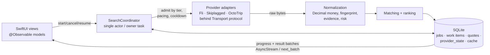

# P5.05 — Native iOS search engine feasibility analysis

Analysis: 2026-11-13 Jakarta. Branch `worktree-p5.05-native-ios-analysis` from main
`984cfd25fed0c1dfd6ee36da99ab8d3d936e282f` (PR #8, P4.13 merge; zero file diff vs
`p4.13-finish-persistence` `8d68c53`). Research and documentation only: no app code, no
installs, **no live provider requests**, no Swift/Rust code compiled or run.
Local toolchain: Command Line Tools + Swift 6.3.3 only — no Xcode, iOS SDK, simulator or
device. **Every on-device statement below is NOT TESTED.**

Labels: **FACT** = read in repo source/docs or an official page (file:line or URL given);
**OBS** = observation recorded in an earlier repo log; **HYP** = inference or hypothesis.

## 1. Executive verdict

- **A standalone native iPhone engine is feasible for Skiplagged and OctoTrip** (HYP on
  device; protocols are plain HTTPS JSON-RPC/SSE that `URLSession` supports — FACT).
- **Fli (Google Flights) is the go/no-go and is unproven in every language.** Python works
  only with `curl_cffi` Chrome impersonation over HTTP/2 (FACT `providers/fli.py:61,142`).
  A plain HTTPX client was redirected to `google.com/sorry` (OBS
  `docs/log/swoop-transport.md:33-35`). Upstream fli-js reports plain `fetch` + Chrome UA
  works (FACT, fli-js README; not CheapWings evidence).
- **Owner decision (2026-11-13): Fli is the highest-priority provider** because it returns
  usable results fastest (consistent with OBS P4.12 live ladder: 59→183 searches/min at
  1 s→0.25 s, no blocks — `WORK_LOG.md` P4.12 checkpoint). Fli on iPhone is therefore a
  **must-have gate, not an optional source**: an iOS engine without Fli does not meet the
  product goal. Scheduler tier is unchanged (Fli is already priority 0, `config.py:32`).
- **The engine's limit on iPhone is iOS lifecycle, not CPU.** iOS offers no guaranteed
  background completion for a multi-minute paced search; the product contract must be
  foreground-first with checkpoint/resume (FACT, Apple docs §5).
- **"Fully native"** here = SwiftUI UI + compiled engine linked into the app, calling
  providers directly. Owner decision (2026-11-13): a compiled Rust library linked into the
  app is acceptable ("no Rust runtime" constraint lifted for a shared core).
- **Owner direction:** web and iOS both long term, ideally **one shared engine**, only the UI
  differing. Two candidates remain equal — **B: Rust core**, **C: Swift core** — to be decided
  by spikes S1–S5 (§7, §8).
- **Distribution:** App Store guideline 5.2.2 requires permission under each provider's
  terms; personal-use install (current owner risk acceptance) is the only realistic channel.

## 2. Provider compatibility matrix

No Swift tests performed for any provider. All verdicts are **not run on device**.

| Provider | Verdict | Native transport | Evidence | Blocker | Effort | Smallest PoC |
|---|---|---|---|---|---|---|
| Fli | **CONDITIONAL GO** | `URLSession` GET of `https://www.google.com/travel/flights?tfs=…&hl=en&gl=…&curr=…`; hand-written protobuf `tfs` (~12 lines, no SwiftProtobuf); 3 regexes for `AF_initDataCallback` `ds:1`; positional row decoder | pin `backend/pyproject.toml:16` fli `881aee5` (MIT); `fli.py:61,71-95,142,153-164,221-258`; `swoop-transport.md:30-39` | Google may serve `/sorry`, consent page, or row-less page to a non-Chrome TLS client; no allowed fallback (no WKWebView, no consent-cookie fabrication, no challenge handling) | M | S1 (§7) |
| Skiplagged | **GO** | `URLSession` JSON-RPC to `https://mcp.skiplagged.com/mcp`: `initialize` → `notifications/initialized` → `tools/call sk_flights_search`; echo `Mcp-Session-Id`; JSON or SSE | `skiplagged.py:15,77-87,110-122`; Python `mcp==2.3.0` negotiates `2025-11-25` | none for protocol; exact money (see below) | S | D1 |
| OctoTrip | **GO** | `URLSession` port of hand-written stateless client: `initialize` (`2025-03-26`) → `tools/call search`; SSE via `bytes(for:)` lines; 2 MB cap; 1.10 s HTTP start gate | `octotrip.py:19,50-76,91-126`; `rate_limit.py:55-77` | none for protocol; 60–90 s responses vs iOS suspension | S | D2 |

Provider details:

- **Fli tfs/decoder (FACT, upstream `881aee5`):** envelope fields 1=28, 2=2, 3=segments,
  8=passengers, 9=seat, 14=1, 19=trip type; segment field 2=date, 5=max stops (omitted for
  "any"), 13/14=origin/dest IATA; unpadded URL-safe base64. Rows `data[2][0]`/`data[3][0]`;
  price `row[1][0][-1]`, currency token `row[1][1]`; leg indices 3,6,8,10,11,20,21,22.
  Times are naive local; CheapWings attaches airport time zones (`fli.py:195-201`).
  Upstream retries a missing `ds:1` ("one page in sixty"); CheapWings raises `schema_changed`.
- **Fli fragility (HYP):** every positional index and the literal `, sideChannel` regex can
  break silently with a Google markup change; upstream has already moved once (RPC endpoint
  gated since 2026-08). On iOS a decoder fix ships only via app update (guideline 2.5.2
  forbids downloaded code).
- **Exact money (FACT/HYP):** Python parses with `parse_float=Decimal` (`common.py:34-35`).
  `JSONSerialization`/`JSONDecoder` go through `NSNumber`/`Double`; the Swift MCP SDK
  `Value` type has only `.int`/`.double`. Native port must scan the raw number lexeme from
  the response bytes (HYP: simplest correct approach) instead of decoding into `Double`.
- **Swift MCP SDK (FACT, `modelcontextprotocol/swift-sdk` 0.12.1, iOS 16+, spec 2025-11-25,
  `HTTPClientTransport` over `URLSession`, deps swift-log/swift-system/eventsource, 0.x may
  break):** protocol-compatible with Skiplagged (HYP) if `streaming: false`. Recommendation:
  one shared ~150-line JSON-RPC helper for both MCP providers — keeps raw bytes, no deps,
  visible 429/Retry-After. Use the SDK only if server push/OAuth/many tools appear later.
- **Data caveats preserved:** Skiplagged has no segment identity and USD+FX display-only
  pricing; OctoTrip is route-summary-only, `provider_complete=False`, not cached, 900 s
  retention; Fli has no basic-economy exclusion (WORK_LOG provider ledger).

## 3. Native engine design and module ownership

Same logical design for both candidates; B implements the core in Rust (UniFFI to Swift),
C in Swift (SwiftPM package).

| Module | Owns | Must not own |
|---|---|---|
| Domain | `Money` (Decimal, ISO currency, minor units, half-even), segments with tz offsets, fingerprint, offers, comparison/price status | I/O |
| Planning | Major/Specific scope, expansion origin→dest→date, 120-combination cap | network |
| Coordinator (one actor) | global in-flight G, tiers + headroom, per-provider start-to-start pacing, 429 cooldown, retries, deadline, cancel, physical-I/O accounting, fair job rotation | UI lifetime |
| Adapters | request build, transport, response decode, provider failure codes | scheduling |
| Storage | durable progress, checkpoint/resume, cache + coalescing, expiry purge | business ranking |
| UI | rendering, response age, "advertised vs verified" labels | engine state |

Concurrency: network is async I/O (no thread per request); HTML/JSON decoding runs off the
coordinator on a bounded executor. Progress is delivered by stream/poll from storage so a
search is not tied to a view's lifetime.

## 4. Port-vs-drop matrix

| Keep (observable semantics) | Evidence | Drop / replace |
|---|---|---|
| Global pool G=9, no per-provider quota | `config.py:23`; P4.12 | FastAPI, REST, owner token, CORS (web keeps them) |
| Start intervals Fli 1 s, Skiplagged 3 s, OctoTrip 5 s; OctoTrip HTTP gate 1.10 s | `config.py:24-27`; `rate_limit.py:58` | POSIX `fcntl` worker lock |
| Tiers (OctoTrip priority 1) + headroom 2 | `config.py:29-33` | Two-process worker/API split |
| Start-to-start pacing durable across restarts | `job_runner.py:67-69`; `repository.py:342,354,474` | Cross-process lease stealing (keep crash recovery only) |
| 429 cooldown incl. late responses; Retry-After; refund if cooldown appears before start | `repository.py:371,454-473,507` | Alembic (replace with in-app migrations) |
| Retry only timeout/429/unavailable, max 3; deadline forces terminal; backoff max(RA, min(60, 2^(n-1))) — **no jitter** (`docs/02:123` says jitter: outdated) | `repository.py:521-536` | |
| Timed-out I/O keeps its slot until it really ends; late results discarded | `job_runner.py:107-149` | |
| No duplicate dispatch; shared in-flight operation per cache key | `job_runner.py:225-236`; `cache.py:28-70` | |
| Finalize: cancelled / completed / partial / failed; skipped counts as not succeeded | `repository.py:155-197` | |
| Expiry: per-item `data_expires_at`, purge, HTTP-200 expired metadata | `verification.py:289-317` | dead `ResultsExpired`/410 |
| Money Decimal-only, unknown currency fails, half-even FX rounding | `domain/money.py:46,139` | |
| Fingerprint = sha256 over Python `isoformat()` bytes | `itinerary.py:108`; `segments.py:45-56` | |
| Ranking with explicit tie-breaks (Python sort is stable; Swift's is not) | `engine/ranking.py` | |
| 120 route/date cap; Major selection must match catalog set | `config.py:14`; `contracts.py:51-76` | |
| P4.13 cost cuts: existence/COUNT queries, set-based purge/clear | `p4.12.md:372-421` | Pydantic TypeAdapter memoization (Python-only) |

Golden-test sources for a port: `test_money`, `test_itinerary`, `test_matching`,
`test_ranking`, `test_expansion`, `test_query_validation`, `integration/test_p412_pool.py`,
`test_scheduler.py`, `test_worker.py`, `test_search_cache.py`, `test_observation_expiry.py`,
`contracts/fixtures/` (176 test functions; 287 passed incl. parametrization per P4.12/P4.13).

## 5. Background / foreground behaviour (iOS)

| Mechanism | Min iOS | Starts now | Survives background | Survives force-quit | Network | Use for CheapWings |
|---|---|---|---|---|---|---|
| Foreground app | — | yes | no (suspended soon) | no | yes | **primary path** |
| `beginBackgroundTask` | 4 | yes | short, undocumented length | no | yes | checkpoint + finish current call |
| `BGContinuedProcessingTask` | **26** | yes if room (`.fail`) | yes, Live Activity, user/system can stop | **no, no callback** | yes | optional iOS 26+ enhancement |
| `BGProcessingTask` / `BGAppRefreshTask` | 13 | no (OS-scheduled) | minutes / ≤30 s | no | yes | maintenance only (purge) |
| Background `URLSession` | 7 | discretionary in background | transfers only | no (cancelled) | upload/download only | **unfit** (no SSE, no orchestration) |

Sources: developer.apple.com BackgroundTasks `bgcontinuedprocessingtask`,
`bgcontinuedprocessingtaskrequest`, `choosing-background-strategies-for-your-app`;
UIKit `beginbackgroundtask(withname:expirationhandler:)`; Foundation
`downloading-files-in-the-background`, `urlsessionconfiguration/background(withidentifier:)`;
WWDC25 session 227.

User-visible policy:
1. Search runs in foreground with progress; durable checkpoint after every provider call.
2. iOS 26+: submit `BGContinuedProcessingTask` (`.fail`, wildcard id) on the Search tap;
   report progress in planned-call units **and keep it advancing during pacing waits**
   (HYP risk: stalled progress → expiry).
3. iOS 17–25: `beginBackgroundTask` from search start; on expiry cancel, checkpoint, end.
4. Next launch: "Resume search (n of N done)"; never auto-resume from a background launch.
5. Network change / `NSURLErrorNetworkConnectionLost`: retry current call; Low Data Mode
   allowed for user-initiated search; Low Power Mode: warn and keep pacing.
6. Store cooldown deadlines as wall-clock times (B: Darwin `Instant` pauses during sleep).

Minimum iOS: **17** (HYP recommendation): Swift MCP SDK needs 16, GRDB 7.12 needs 13,
`@Observable` needs 17; continued processing guarded by `#available(iOS 26, *)`.

## 6. Risk register (likelihood × impact, 1–5)

| # | Risk | L | I | Score | Mitigation |
|---|---|---|---|---|---|
| R1 | Google serves `/sorry`/row-less page to iOS transport (Fli) | 4 | 5 | 20 | S1/S2 before any build; Fli optional per platform |
| R2 | Google markup change breaks positional decoder; fix needs app release | 4 | 4 | 16 | golden fixtures; fail closed `schema_changed`; server keeps working |
| R3 | Search interrupted by suspension/force-quit | 5 | 3 | 15 | foreground-first, checkpoint/resume, iOS 26 continued processing |
| R4 | Provider terms / App Store 5.2.2 | 3 | 5 | 15 | personal install only; revisit before any public release |
| R5 | One-developer cost of shared core (Dropbox C++ precedent) | 3 | 4 | 12 | spikes first; strangler migration; stop rule |
| R6 | B: `wreq` Chrome client fails on iOS (wreq #1089, maintainer "don't use iOS") | 4 | 3 | 12 | `Transport` trait; URLSession on iOS |
| R7 | C: no Swift Chrome-like client for server Fli | 4 | 3 | 12 | S3; keep Python/`curl_cffi` Fli during migration |
| R8 | Exact-price loss via `Double` (JSONSerialization, MCP `Value`) | 3 | 4 | 12 | raw-lexeme parsing + money fixtures |
| R9 | Fingerprint/rounding drift between engines | 3 | 4 | 12 | shared fixtures incl. isoformat and half-even cases |
| R10 | B tooling: UniFFI 0.x, partial Swift 6 Sendable, no built-in cancel, cargo-swift lag | 3 | 2 | 6 | pin versions; explicit cancel token; polling stream |
| R11 | iPhone memory/battery from 9 concurrent calls + HTML parsing | 2 | 3 | 6 | bounded body (4 MB), lower G on cellular/low power |

## 7. Experiment plan (proposal; nothing run; each needs owner approval)

Prerequisites: full Xcode, Apple developer signing, physical iPhone (iOS 17+, one iOS 26+),
same Wi-Fi network as the Python baseline. No challenge bypass, proxy/identity rotation or
consent-cookie fabrication. Stop at first `/sorry`, CAPTCHA or 429; record and do not retry.

| Spike | Steps | Pass | Stop / fail |
|---|---|---|---|
| **S1** Fli via plain `URLSession` on device | one route/date, Release build, Chrome-like UA only; build `tfs`, GET, extract `ds:1`, decode ≥1 priced row, keep price lexeme as Decimal, cross-check airports/date, generic search link | 3/3 single requests return priced rows | any `/sorry`, consent page, or row-less 200 |
| **S2** `wreq` Chrome client on device (B) | Rust static lib via UniFFI, same request as S1 | handshake + priced rows 3/3 | `ErrorStack([])` / crash (512 KB thread stack) |
| **S3** Fli from Swift on server (C) | macOS/Linux Swift (AsyncHTTPClient; or `curl-impersonate` via C) | priced rows 3/3 at Fli 1 s interval | `/sorry` on both transports |
| **S4** PyO3 shadow port of `domain/money` (B) | Rust money behind existing Python API; run `test_money` + full suite | 287 pass, identical outputs | any diff in rounding/formatting |
| **S5** Core skeleton both ways | B: UniFFI+tokio+rusqlite XCFramework; C: SwiftPM core on iOS + Linux; both run money/fingerprint/ranking fixtures | fixture parity 100 %; app size delta measured | parity failures on Linux `Decimal` or isoformat |
| D1 Skiplagged | JSON-RPC helper: initialize, initialized, one search | valid priced offer, Decimal intact | protocol error |
| D2 OctoTrip | JSON-RPC + SSE | valid offer, cancel mid-stream releases slot | hang > 90 s |
| D4 Coordinator synthetic | fake providers, G8/G16/G32, intervals, tiers, late high-priority job, retries, cancel | zero over-admission, zero duplicate dispatch, pacing gaps ≥ interval | any violation |
| D5 SQLite recovery | kill/relaunch mid-search, expiry, cancel | resume without duplicate provider call | duplicate or lost item |
| D6 Device conditions | Wi-Fi↔cellular, Low Data, background after start, battery/CPU/memory | first valid fare ≤ Python baseline + 20 %; no crash; memory < 150 MB | jetsam / runaway CPU |

Metrics (same requests and intervals as Python baseline; never shorten pacing without
approval): p50/p95 time-to-first-valid-fare, total coverage time, operations/min, priced
offers, skipped/failed/429 rates, peak physical in-flight, memory, CPU, battery.

**Decision rule:** S3 fails → **B**. S3 passes and S5(C) Linux parity passes → **C**
(cleaner). S1 fails and S2 passes → **B** (only native Fli path). S1 and S2 both fail → Fli is
not native on iPhone in either option, and because Fli is the must-have provider the
**standalone-iPhone goal fails**; stop P5 engine work and return to the owner (options then:
relax the standalone constraint for Fli only, or accept an iPhone app without its fastest
source). Run **S1 first**: it is the cheapest test and gates everything else.

## 8. Architecture decision record

Owner criteria: cleanest, fastest, most scalable; web + iOS long term; one engine.

| Option | Clean | Speed | Scale (server) | iOS fit | Web migration | Verdict |
|---|---|---|---|---|---|---|
| A. Python web + separate Swift iOS engine, synced by fixtures | 3 | tie | 4 | 5 | none | fallback only — rules written twice forever |
| **B. Rust core** (PyO3 in FastAPI, UniFFI in iOS) | 3 | tie | **5** | 3 | **gradual, web never breaks** | **candidate** |
| **C. Swift core** (iOS + Swift server) | **5** | tie | 3 | **5** | rewrite or separate engine process | **candidate** |
| D. Embedded Python on iOS | 1 | tie | — | 1 | — | reject: unsupported runtime, size, App Review risk |
| E. Hosted server + thin iOS client | 4 | tie | 4 | — | none | reject: violates standalone constraint |
| F. Rust→WASM engine in browser | — | — | — | — | — | reject: CORS + no TLS control; web still needs a server |

- **Speed is a tie** (HYP, strongly supported): searches are bound by provider pacing
  (1–5 s) and network latency; P4.12 showed Fli's interval, not G, throttles it.
- **Fli priority weighs the choice:** whichever core is chosen must keep Fli working on
  *both* web server and iPhone. Server Fli is proven today only with a Chrome-like client
  (`curl_cffi`); B has an equivalent (`wreq`), C has none (S3 must pass for C).
- **B detail (FACT unless noted):** `core/` workspace: `cheapwings-core`, `py` (PyO3 0.30 /
  maturin, `pyo3-async-runtimes`), `ffi` (UniFFI 0.32.2, MPL-2.0). Strangler order: money →
  query → engine/locations → provider parsers → transports; storage, leases, API and
  `contracts/openapi.yaml` stay Python. iOS links the same crate with its own rusqlite file,
  `pause/resume/checkpoint`, polling `next_batch()`, explicit cancel token. Precedents:
  Mozilla application-services, Signal libsignal, 1Password, Bitwarden, Matrix/Element X,
  Proton. Counter-precedent: Dropbox shared C++ (2019, "more expensive than writing it twice").
- **Shareable code (HYP from LOC):** backend is 6,174 LOC; ~35–40 % certainly shareable
  (domain, engine, locations, parsing), ~55–65 % if transports and SQLite are shared.
  Hidden cost: re-implementing fli's `_tfs` and decoders (and swoop if kept) — the owner then
  maintains the Google decoder directly.
- **Fli TLS is not solved by Rust on iOS** (FACT: wreq #898 sim compile fixed; #1089 runtime
  failure on iOS 26 sim, closed without fix). Both B and C need a `Transport` abstraction.
- **Swift core gaps (HYP, not deep-researched):** server-side Swift ecosystem and
  Linux Foundation `Decimal` parity; no PyO3 equivalent, so no in-process gradual migration.

## 9. Minimal P5 sequence

1. **P5.05 (this):** analysis + owner decisions. Done.
2. **P5.06 spikes:** S1 (Fli gate) → S2/S3 → S4 → S5 (owner approves each; needs Xcode +
   device). Stop if S1 and S2 both fail (§7).
3. **P5.07 decision:** apply the §7 rule; record B or C as an approved deviation from
   `docs/05`/`docs/06` P5 (which still describe iOS as a thin REST client — `docs/05:5,99`).
4. **P5.08 shared core:** contract fixtures generated from Python (`contracts/fixtures/`),
   `contracts/ENGINE_VERSION`; port domain/engine first (B via PyO3 strangler; C as SwiftPM).
5. **P5.09 iOS app:** `apps/ios/` (already planned, `docs/02_SYSTEM_ARCHITECTURE.md:60`) —
   Xcode app + core; **Fli first** (highest priority, fastest results), then Skiplagged and
   OctoTrip.
6. **P5.10 lifecycle:** checkpoint/resume, iOS 26 continued processing, device metrics (D5–D6).

Out of scope now: swoop port (legacy/deferred), App Store submission, push notifications,
shared UI, any shortened provider pacing.

Owner decisions needed: approve spikes (and Xcode install); minimum iOS (17 proposed);
distribution channel (personal install); production G for the iOS engine on cellular.
Decided: Fli is the must-have, highest-priority provider (2026-11-13).

## 10. Sources, facts and open questions

Repo HEAD `984cfd25fed0c1dfd6ee36da99ab8d3d936e282f`. Repo files cited inline.

External (read 2026-11-13):
- Fli pinned commit: https://github.com/punitarani/fli/tree/881aee5ff4321e81ea2157cb44be94ce6a21dc1b
- Swift MCP SDK: https://github.com/modelcontextprotocol/swift-sdk
- GRDB: https://github.com/groue/GRDB.swift
- Apple: https://developer.apple.com/documentation/backgroundtasks/bgcontinuedprocessingtask ,
  https://developer.apple.com/documentation/foundation/downloading-files-in-the-background ,
  https://developer.apple.com/videos/play/wwdc2025/227/ ,
  https://developer.apple.com/app-store/review/guidelines/ (2.5.1, 2.5.2, 2.5.4, 4.2, 5.1.1, 5.2, 5.2.2)
- Rust: https://github.com/mozilla/uniffi-rs , https://mozilla.github.io/uniffi-rs/latest/swift/overview.html ,
  https://github.com/0x676e67/wreq (issues 898, 936, 1089) , https://pyo3.rs ,
  https://doc.rust-lang.org/rustc/platform-support.html
- Precedents: https://dropbox.tech/mobile/the-not-so-hidden-cost-of-sharing-code-between-ios-and-android ,
  https://github.com/mozilla/application-services , https://github.com/signalapp/libsignal ,
  https://github.com/bitwarden/sdk-internal , https://github.com/matrix-org/matrix-rust-sdk ,
  https://1password.com/blog/1password-8-the-story-so-far

Outdated documentation found (not fixed here):
- `WORK_LOG.md` still shows P4.12 as "not pushed" and lacks P4.13 (merged PR #7 `00c2fbb`,
  PR #8 `984cfd2`); test count 269 vs 287.
- `docs/02_SYSTEM_ARCHITECTURE.md:114,132` per-provider semaphores (removed in P4.12);
  `:123` jitter (not implemented); `:49-55` lists non-existent modules.
- `docs/05`/`docs/06` P5 describe a thin REST iOS client — superseded by owner direction,
  pending the P5.07 deviation entry.

Open questions:
1. Does Google return `ds:1` rows to iOS `URLSession` / to `wreq` on iOS? (S1/S2)
2. Does slow-but-paced progress keep `BGContinuedProcessingTask` alive?
3. Real `beginBackgroundTask` budget on current iOS (no documented number).
4. Swift on Linux `Decimal` and `isoformat`-equivalent parity (S5).
5. App size delta of BoringSSL (B) — estimated 2–4 MB, unmeasured.
