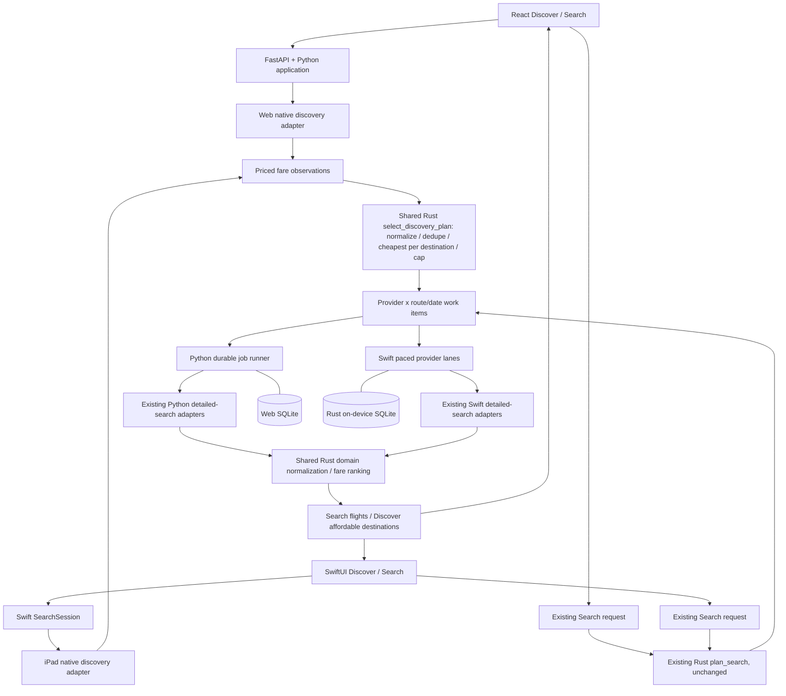

# CheapWings — P7 Explore Anywhere / Discover
## Implementation Handover for Local Agent

**Prepared:** 2026-11-19 (Asia/Jakarta)  
**Repository:** https://github.com/farhaniqbalta/CheapWings  
**Verified planning baseline:** `main` at `b7f17b0` (re-checked 2026-11-21: PR #20, #21, #22 P5.7 cp3 parser cutover, #23 P6 release acceptance and #24 CI merged). **Read remote state again before creating a branch.**  
**Status:** P7 *proposed*, not implemented or automatically authorized. P6 is accepted (PR #23) and P5.7 checkpoint 3 is merged (PR #22), so both dependencies are met.

---

## 0. Read this first — non-negotiable owner intent

**Explore Anywhere must search for cheap flights, NOT generate random destinations and then price them.** The destination is the *result* of fare-first discovery. Use priced observations (ideally origin + destination + departure date + price), select promising routes/dates, and check them with existing detailed-search providers.

- Maintain two distinct product features: **Search** (the existing user-specified destination experience) and **Discover / Explore Anywhere** (find low-priced routes across an unspecified destination set).
- **Search remains exhaustive** over the specifically requested, validated route/date combinations, subject to its existing cap. Do not introduce discovery shortlisting into normal Search.
- **Discover is intentionally bounded** and must report *discovered coverage*, never claim it searched every possible destination or found the global cheapest fare.
- **Surprise Me** is only an optional selection among already-found affordable results. It must never replace price discovery with random airport picking.
- **No second detailed-flight search engine, no separate autonomous search scheduler, no new Rust HTTP service, and no wholesale migration of Python or Swift runtimes.**
- Keep web (React + FastAPI/Python worker) and native iPad (SwiftUI + on-device Swift networking) viable independently. iPad must not silently depend on a hosted CheapWings backend.
- Accuracy, price provenance, reliability, bounded provider traffic and **search speed** are critical. Avoid exhaustive per-destination brute force.
- Work in owner-reviewed checkpoint PRs. **Never merge automatically**. Obtain owner authorization before live provider probes, new toolchains, paid accounts, changed provider rates, or implementation of unapproved scope.

## 1. Actual repository state and migration dependency

At last verification:

| Area | Status / implication |
|---|---|
| P5.1 Rust core | Implemented: `core/cheapwings-core`, `cheapwings-py` (PyO3), `cheapwings-ffi` (UniFFI). |
| P5.4 native providers | Merged. iPad has Fli and Skiplagged, provider-neutral `SourceOffer`, MCP client, per-source paced lanes and SQLite schema v2. **OctoTrip on iPad intentionally deferred.** |
| P5.8 native execution | Merged. Swift `PacedRunner` supports provider concurrency/pacing, ordered events, cancellation, recovery. |
| P5.7 checkpoint 1, PR #20 | **Merged.** Owner revised P5.7 scope; documentation and plan updated. |
| P5.7 checkpoint 2, PR #21 | **Merged** to `main` at `434b9e7c`. Python web uses Rust through PyO3 for money, fingerprinting, ranking, route/date expansion, scope preview, and locations/major-airport resolution. The binding versions are checked against the source revision. |
| P5.7 checkpoint 3 | **Merged** (PR #22, branch `p5.7-parser-cutover`, 2026-11-19): web Fli and Skiplagged results decoded by the existing Rust parsers. |
| Deferred from P5.7 | **OctoTrip/swoop parsers remain in Python. Web durable scheduling stays Python; native paced scheduling stays Swift.** Do not reintroduce earlier proposals to port schedulers to Rust. |
| P6 | **Merged** (PR #23): offline acceptance, live canaries, signed iPad build and owner acceptance. |
| P7 | Proposed, not started. Existing P7 docs describe a high-level version of this feature. |

Sources of truth to inspect in the *current checkout*, in this order:

1. `WORK_LOG.md` and `docs/log/p5.7-plan.md`, `docs/log/p5.7.md`
2. `docs/01_PRODUCT_REQUIREMENTS_UX.md`, `docs/02_SYSTEM_ARCHITECTURE.md`, `docs/03_PROVIDERS_AGGREGATION_PRICING.md`, `docs/06_IMPLEMENTATION_CHECKPOINTS.md`
3. `core/cheapwings-core/src/{money,locations,planning,ranking,skiplagged,fli}.rs`
4. `core/cheapwings-py/src/lib.rs` and `core/cheapwings-ffi/src/lib.rs`
5. `backend/src/cheapwings/application/{job_runner,search_service}.py`, provider registry/adapters, storage repositories
6. `apps/ios/CheapWingsKit/Sources/CheapWingsKit/{MCPClient,SearchProvider,SearchEngine,SearchSession,PacedRunner,SkiplaggedSearchProvider}.swift`
7. `core/cheapwings-store/src/lib.rs`, React app routes/components and iPad app view-models.

P5.7 checkpoint 3 (PR #22) and P6 (PR #23) are both merged; the remaining gate before P7.2 is the P7.1 provider go. `main` can have advanced beyond the hash above.

## 2. Product definition

### 2.1 Inputs

MVP: origin airport(s) or an existing Major-airport city/country selection; flexible one-way departure range; one adult; economy; display currency; optional maximum fare budget; optional maximum stops if supported by detailed providers. Destination country/region filters are optional **only if the validated discovery source supports them reliably**; otherwise defer them.

### 2.2 Output and sorting

Show **destinations ranked by the cheapest comparable detailed-search fare found**, with date, origin/destination, source, and honest price status. Display observed discovery prices early *as provisional leads*, visibly separate from detailed-search results.

The UI should distinguish:

| Evidence dimension | Meaning |
|---|---|
| `discovery_observation` | Historical/cached/indicative *from* price, possibly stale. Used to prioritize verification, **not** a selectable, verified quote. |
| `detailed_quote` | Price freshly retrieved for a specific origin, destination and date; its status can still be `indicative` (e.g. Fli or Skiplagged). Freshness **does not** automatically make it `recent_search` or `repriced_exact`. |
| `repriced_exact` | Only when an actual eligible provider can confirm the exact fare/brand/availability under existing verification rules. |

Unpriced destination suggestions are dropped at the adapter boundary; only their count is kept for coverage. They never become an evidence level or a result.

**Model `observed_at`/`fetched_at`, `source_kind`, `provider_price_status`, `currency/FX comparability`, and `verified_at` independently.** The screen a price appears on must not determine its evidence status.

**Budget rule for the MVP:** A discovery estimate can put a candidate in the verification shortlist, even if it is close to the limit. Only a detailed, comparable fare at or under budget can be labelled as *checked within budget*. Never silently equate display-only FX estimates to guaranteed payable prices. For unknown baggage/extra fees, carry existing comparison uncertainty forward.

**What does cheapest mean?** Lowest comparable **absolute one-way fare** under specified constraints—not largest percentage discount, historical deal score, popularity, or randomized destination preference.

### 2.3 Honest coverage

Display observed candidate count, selected shortlist count, checked route/date count, checked destination count and unresolved provider failures. Message should be “Lowest fares found among X discovered destinations; Y checked,” **never** “cheapest anywhere in the world.”

If all discovery providers fail, show an explicit unavailable/empty state, not a fallback list of random destinations. If provider coverage is sparse in Indonesia, say so.

## 3. Target architecture — after completed P5.7 and P6



This is **logical** topology. Do not route iPad execution through FastAPI, and do not make the Rust core send network requests. Each platform invokes the same pure Rust selection/planning/ranking functions through its native binding. The schedulers are deliberately **not shared** after revised P5.7.

### 3.1 Existing vs new responsibilities

| Concern | Owner | P7 action |
|---|---|---|
| Airport catalog / Major selections | Rust `locations` | Reuse. |
| Currency and exact amount comparison | Rust `money`/ranking | Reuse, retain price evidence, never convert via imprecise float. |
| Normal Search expansion | Rust `planning::plan_search` | **Preserve unchanged.** |
| Priced observations → explicit route/date plan | New Rust `discovery` module | **Add** one pure entry point, `select_discovery_plan`, reusing `planning`'s airport/date validation; no Cartesian expansion. |
| Existing Fli and Skiplagged detailed parsers | Rust core after P5.7 cp3 | Reuse. Never assume discovery-response schemas equal detailed-search schemas. |
| Web network, admission/retries/cache and job lifecycle | Python | Extend existing job flow for discovery stage; preserve SQL claims, leases, fencing and global pool behavior. |
| iPad network, provider lanes, app lifecycle | Swift | Extend native stage orchestration; retain per-provider pacing and offline/resume rules. |
| iPad storage | Rust `cheapwings-store` | Extend conservatively with versioned migration. |
| Web storage | Python / SQLAlchemy + SQLite | Extend conservatively with migrations, transaction/claim semantics. |
| Frontends | React / SwiftUI | Add **separate top-level Discover** feature; Search unchanged. |

**Do not migrate OctoTrip/swoop to iPad merely for P7.** Their web-only availability is an explicit owner decision. Their parsers remain Python-native unless new requirements justify a change.

## 4. Provider feasibility is a hard stop (P7.1)

**Do not choose a provider solely because it has an endpoint named “Explore.”** Validate it returns priced route/date observations suitable for one-way fare-first discovery.

Research candidates, in priority order (not approvals):

1. **Skiplagged Anywhere** (`sk_destinations_anywhere` per published MCP docs): first technical candidate because native iPad already has the Skiplagged MCP handshake/session infrastructure. Its actual callable name, arguments, result schema, one-way semantics, price freshness and terms must be verified live under owner-approved low-volume probes.
2. **Fli / Google Explore:** investigate whether it reliably produces *priced* destination observations and departure dates, rather than only place suggestions. Undocumented Google interfaces may be fragile or blocked.
3. **Travelpayouts / Aviasales Data API:** potentially useful cached origin→destination+date prices, but evaluate personal-use access, token exposure on standalone iPad, data provenance, access/aggregation restrictions and price age. Do **not** assume Search API rules are the same as Data API rules.
4. **Other browser-dependent methods (e.g. Viajante) or swoop Explore:** only research references; avoid introducing Chromium or a Python server dependency into the standalone iPad app. Unpriced-only destination lists fail the fare-first MVP gate.

For representative Indonesian origins (CGK, SUB, DPS) and at least two time windows, measure using a **preapproved small probe budget**:

- Valid priced observations per request, unique destination count, presence of exact dates, one-way semantics and flight restrictions.
- Fraction with usable comparable currency and known age/freshness.
- Whether promising observations can be found by an existing detailed provider at an approximately comparable fare/date.
- Error/429/block behavior, response sizes, call latency, observed regional biases, reproducibility.
- Terms, permitted combining/reuse, authentication and native `URLSession` feasibility without shipping a secret in an iPad binary.

**Go/no-go:** Select one permitted, reliable priced-discovery provider only when it passes the contract above. Otherwise stop P7 implementation, publish feasibility findings and ask the owner to select an alternative. Do not disguise random airport searches as discovery.

## 5. Core contracts — proposed, finalize in P7.2

Suggested conceptual Rust types (names can adapt to current conventions):

```rust
struct DiscoveryQuery {
    origins: Vec<String>,
    departure_from: String,
    departure_through: String,
    display_currency: String,
    budget: Option<String>,
    max_stops: Option<u32>,
    // no max_work_items input: derived as selected route/dates x enabled providers, checked against the limit
}

struct DiscoveryFareObservation {
    origin: String,
    destination: String,
    departure_date: Option<String>,
    amount: Money,           // required: same exact representation SourceOffer uses; unpriced rows never reach Rust
    source_id: String,
    observed_at: Option<String>,
    fetched_at: String,
    price_kind: String,      // historical | cached | indicative | unknown
    fare_restriction: Option<String>, // e.g. hidden-city / skiplag; reuse existing Skiplagged restriction values
    source_reference: Option<String>,
}
// comparable (display-currency) amount is computed by Rust `money` from the FX snapshot, never supplied by a provider

struct DiscoverySearchPlan {
    selected: Vec<RouteDate>,
    observed_count: u32,
    unpriced_dropped_count: u32,
    excluded_count: u32,
    coverage_notes: Vec<String>,
}
```

Keep a separate source-neutral discovery-provider protocol in Python and Swift. Providers may implement `detailed_search`, `priced_discovery`, or both (capabilities instead of provider-name switches). Unpriced observations cannot enter the “cheapest” ranking. Never store secrets or opaque provider-only selectors in public results or logs.

**Planning:** The existing `plan_search(origins, destinations, date_from, date_through, cap)` (`planning.rs`) expands a Cartesian product. **Do not reuse it for Discover**, and update `docs/02` (which still says the shortlist feeds `plan_search`) in P7.2. Add **one** pure Rust entry point, `select_discovery_plan(observations, query, fx) -> DiscoverySearchPlan`, that reuses `planning`'s airport/date validation and does selection and planning together. There is no separate `plan_targeted_search` and no policy-version parameter in the MVP.

**Caps, in order of precedence:** (1) the discovery call budget limits discovery requests; (2) `120` is the **route/date ceiling** for the selected plan, not a throughput target; (3) work items = selected route/dates × enabled detailed providers, a derived check against the existing work-item limit and never a separate input.

**Selection policy (MVP):** Normalize → filter impossible/unsupported rows → dedupe identical route/date/source observations, keeping provenance → keep the cheapest comparable observation per destination → take the top N by comparable price under the cap. Cheapest-per-destination already provides diversity. A diversity floor and nearby-date probing are deferred until P7.7 yield data justifies them. No random destinations and no popularity rank. Tie rules are deterministic and tested across PyO3/UniFFI. User-specified destination restrictions remain hard filters.

**Verification independence:** When the discovery source also does the detailed check (e.g. Skiplagged Anywhere → Skiplagged search), the check shows freshness, not independent confirmation. Report verification yield per (discovery source → checking provider) pair. Hidden-city/skiplag leads that Fli cannot reproduce are expected, not misses; carry `fare_restriction` through to the result card.

**Cross-platform parity:** Given the same normalized observations, FX snapshot, query and Rust source revision, Rust must produce identical selections and ranking on web and iPad. Different live providers may naturally return different input observations; do not promise identical live result coverage.

## 6. Execution and persistence integration (P7.4)

Use **two explicit stages** for MVP rather than interleaving unbounded discovery with detailed search:

1. `discovering`: existing native transport calls a discovery source under bounded admission and provider rate limits.
2. In **one transaction**: save the observation snapshot + provenance, run `select_discovery_plan` (pure and synchronous, so it is not a persisted stage), and enqueue ordinary detailed `provider × route/date` work items in the existing web/iPad execution stores, then move the job to `checking`. A restart re-runs the transaction or finds it committed, so crash invariants 1–2 hold by construction.
3. `checking`: existing schedulers, adapters, cache/retry/cooldown and progress handling process the selected items.
4. `completed` / `partial` / `unavailable` / `cancelled`: preserve completed results, disclose remaining work and coverage.

For the **web**, use the current durable Python job runner, SQL transactions, capacity, cache and restart fencing; do not create an additional detached worker. Reuse the `SearchJob`/`WorkItem` tables with a `kind` (search | discover) column plus one observations table; do not add a parallel job model. For **iPad**, extend `SearchSession`/SQLite history version carefully; preserve independent source stops and app foreground pause/resume. If a source requests an excessive Retry-After, stop/cool down the relevant provider without evasion.

**Crash/restart invariants:** (1) a discovery snapshot is not duplicated after restart, (2) detailed work is not enqueued twice, (3) finished offer work remains finished, (4) a provider stop does not erase other providers' results, (5) no uncontrolled continuation in the iOS background, (6) a failed source does not cause fabricated destinations.

The web and iPad may use distinct storage schemas, but share logical states, contracts and deterministic Rust selection. Clearly label no results vs source unavailable vs no prices under budget vs partially checked.

## 7. UI scope (P7.5 / P7.6)

**Navigation:** A top-level `Search | Discover` choice. Search form, search matching and exhaustive route/date semantics remain unchanged. Discover has origin, flexible dates, optional budget and supported filters. Show preliminary discovered deals quickly, then replace/augment them with detailed checked fare evidence, preserving original observation provenance.

**Discover result card minimum:** destination/airport, one-way price + currency, exact departure date when known, origin, source, pricing evidence label, observation time/age, checked status, restrictions/unknown fees and an existing provider deep link when valid. Support sorting by comparable observed price, with checked results prioritized by validated evidence rules. A source with missing FX comparable amount is not ranked against display-currency prices.

**Progress:** `N candidates discovered`, `M route/date checks planned`, `K checked`, `L destinations with comparable detailed fares`, source errors/cooldowns. State “covered among discovered candidates,” not “all destinations searched.”

**Surprise Me:** optional small UI action over *already checked, budget-eligible* results; deferred if its selection rules are not approved. No independent provider work and no random airport generation. Drop the shared seeded Rust random helper proposed in `docs/02` until Surprise Me is approved.

Keep UI minimal, responsive and consistent with existing React and SwiftUI visual conventions. No map/gallery, content recommendations, accommodation or flight booking in MVP.

## 8. Implementation checkpoints and merge gates

| Checkpoint | Deliverable | Gate before next |
|---|---|---|
| **P7.0 Readiness** | Confirm P6 and P5.7 cp3 (both merged), inspect current code and confirm scopes. | Owner approves P7 start. No code before the P7.1 go. |
| **P7.1 Feasibility** | Provider comparison, documented low-volume probes if approved, representative ID-origin coverage and usage rights. | One permitted source with price-bearing routes/dates; otherwise no-go. |
| **P7.2 Contract** | Discovery input/observation/evidence/provider capability types; fixture examples; response/UI semantics. | Schema review, unchanged Search compatibility. |
| **P7.3 Shared Rust selection** | Pure candidate normalization, shortlist and targeted planner; PyO3+UniFFI; immutable fixtures. | Deterministic parity, caps, exact price, dedupe and invalid data tests. |
| **P7.4 Runtime/persistence** | Two-stage Discover lifecycle through *existing* Python/Swift runtimes; storage migrations; resume/cancel/retry. | Offline fake-provider E2E; restart, rate limits and cancellation gates. |
| **P7.5 Web UI** | React Discover form, progressive result cards, coverage/evidence. | Browser/a11y/mobile tests, Search unchanged. |
| **P7.6 Native UI** | SwiftUI Discover form/results, direct provider adapter if authorized/feasible. | Device/simulator release build, offline/resume, no backend dependency. |
| **P7.7 Acceptance** | Test report, real canary evidence when approved, performance/quality metrics, docs, owner signoff. | Stable release decision and explicit limitations. |

Do not combine checkpoints merely to save PR count if it obscures behavior changes. Each checkpoint owns a short `docs/log/p7.x.md` with commands/results/limitations. Update `WORK_LOG.md` compactly and do not overwrite unrelated milestone work. Follow current repository PR/branch conventions.

## 9. Acceptance tests and evidence

**Domain/unit:** source schema changes, empty results, stale/unknown observation time, currency not comparable, exact arbitrary decimal ordering, negative/impossible fares, duplicate observations, mixed airports, invalid date/airport, date-window boundaries, deterministic ties, budget enforcement, capped output, source-dependent limitations and same-origin/destination exclusion.

**Planner:** a set of priced observations across scattered dates **must not** expand into `all destinations × all dates`; ordinary Search must continue its previous expansion. The 120 route/date cap is preserved. The derived work-item count (route/dates × enabled detailed providers) is checked against the limit to prevent accidental request multiplication.

**Job lifecycle:** source 429+Retry-After, 401/403 block, timeout, offline, restart during discovery, restart between snapshot and enqueue, restart during check, cancellation, app background, provider partial success, stale offers, no false “0 flights” on upstream failure. Use fakes first, no live traffic in CI.

**Cross-platform:** same observation/query/policy fixtures through PyO3 and UniFFI produce identical targeted lists and ranking. SwiftUI uses its own network scheduler. Verify both native binaries/extensions rebuilt from the *same* Rust source revision and enforce current binding-revision checks.

**Quality metrics:** number of *distinct destinations with comparable detailed fares below budget* per minute; discovery candidates with exact route/date/price; verification yield; request count per affordable destination; average/p95 wall-clock duration; upstream error/429 rate. Compare against a **bounded synthetic baseline**, not fabricated live performance claims.

**Acceptance wording:** “Most affordable flights we found within checked discovery coverage,” not “global cheapest flights.” Include an end-to-end user example with fake prices clearly marked fictitious.

## 10. Required agent output before coding

1. Report the actual `main` SHA and milestone state; verify P5.7/P6 dependencies.
2. Report exact classes/functions to reuse and where dynamic discovery stage hooks will attach. Avoid speculative files or renaming existing entry points without evidence.
3. Produce a provider feasibility matrix with verified schemas, restrictions, native reachability, Indonesian-origin coverage and unknowns. **Do not run live probes without approval.**
4. Produce a scope delta against the present P7 documentation, a checkpoint PR plan, new data contracts and regression gates.
5. Obtain owner approval for P7.1 probes and implementation go/no-go. Until approved, documentation and analysis only.

### Explicit exclusions

Do not silently implement Explore now; do not modify P5.7 or P6 status to “done” without evidence; do not move web/iPad schedulers into Rust; do not port OctoTrip/swoop to iPad; do not create a second provider search service; do not include random destination guesses, maps, lodging, roundtrips, booking or alerts in the P7 MVP; do not treat cached discovery fares as checked or verified prices.

---

## Reference links

- Repository: https://github.com/farhaniqbalta/CheapWings
- P5.7 checkpoint 1: https://github.com/farhaniqbalta/CheapWings/pull/20
- P5.7 checkpoint 2: https://github.com/farhaniqbalta/CheapWings/pull/21
- Existing P7 roadmap: `docs/06_IMPLEMENTATION_CHECKPOINTS.md`
- Existing product scope: `docs/01_PRODUCT_REQUIREMENTS_UX.md`
- Existing P7 architecture: `docs/02_SYSTEM_ARCHITECTURE.md`
- Provider research list: `docs/03_PROVIDERS_AGGREGATION_PRICING.md`
- Revised migration source of truth: `docs/log/p5.7-plan.md`

**Final principle:** Discover expensive destinations *from cheap observed flights*, not cheap flights from random destinations. Use one shared Rust decision core and reuse each platform's existing detailed-search execution engine.
