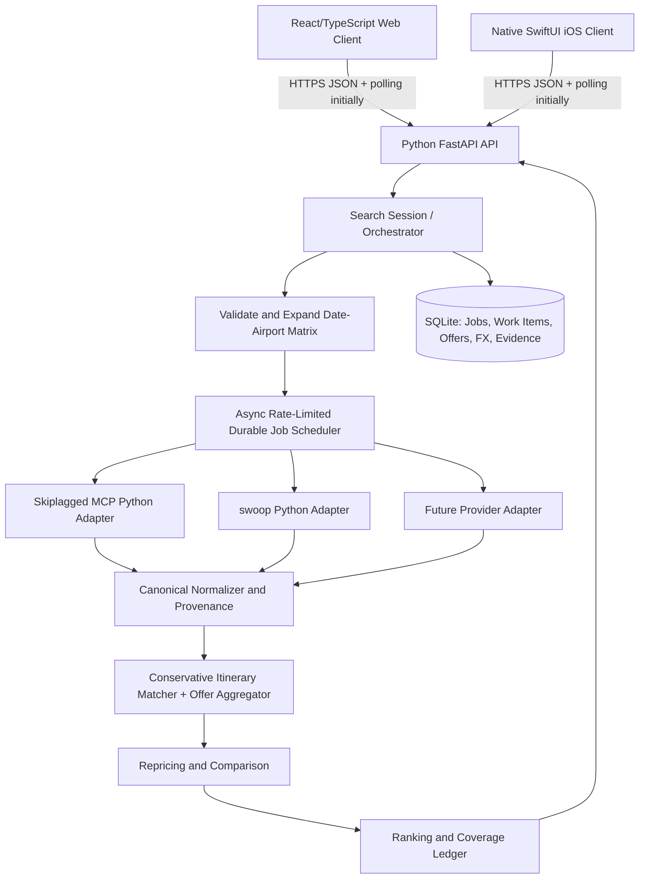

# FlightFinder — Architecture & Design Review Handoff

> **Document type:** Product/technical plan for an independent reviewing agent (NOT an implementation order)  
> **Status:** Proposed architecture; provider behavior not yet validated by live test  
> **Prepared:** 2026-11-09  
> **Priority:** Fare accuracy and breadth of search > speed > convenience  
> **Target:** Lightweight personal flight-price search tool on web and native iOS; no checkout or booking capability
> **Revision:** V4 — full-length architecture restored; simplified Python/FastAPI backend; web + native iOS; multi-provider aggregation retained (2026-11-09)

---

## 0. Instructions to the Reviewing Agent

You are the **critical architecture and feasibility reviewer**, not an implementation worker yet.

1. **Challenge this proposal**. Do not treat any provider claim, interface, rate limit, availability, or price-accuracy assumption as proven.
2. Research the current public documentation and inspect relevant open-source repos before approving the providers or technology stack. Where permitted, run *small, respectful* live integration tests; no aggressive automated scraping or attempts to evade access restrictions.
3. Preserve the product's non-negotiable requirements (Section 1); propose simpler or more robust approaches where appropriate.
4. Identify weaknesses in how we measure the "cheapest" fare, how we compare like-for-like tickets, and what the product can reasonably promise.
5. Distinguish **documented**, **observed**, **assumed**, and **unsupported** behavior. Provide evidence URLs, observation date, and minimal reproduction steps for key feasibility claims.
6. Do **not** begin building the complete application before the review findings and recommendation are accepted. A disposable proof-of-concept (PoC) for assessing APIs is allowed.
7. Produce the deliverables specified in Section 15, especially a recommendation with a clear **GO / CONDITIONAL GO / NO-GO** conclusion.

**Decisions requested from reviewer:** (a) Can an inexpensive flight search cover the requested airport/date pairs and rank the cheapest **usable, recently checked** one-way fares across multiple providers? (b) Does a **single Python backend** provide a reliable, maintainable implementation of all approved providers? (c) What must remain server-side versus client-side, and what is the simplest durable long-running job design?

---

## 1. Product Intent, Requirements, and Non-Goals

### 1.1 Problem

A user has flexible travel dates, potentially more than one acceptable arrival airport, and wants to find the lowest viable flight price without manually checking each day and airport. A slower search is acceptable if it yields better coverage and confidence.

**Illustrative scenario, not a live request:**
- Origin: Melbourne (`MEL`)
- Destinations: Jakarta (`CGK`), Denpasar/Bali (`DPS`), Surabaya (`SUB`)
- Departures: 2026-12-12 through 2026-12-20 (inclusive)
- One way, one adult, economy, display IDR
- Lowest-cost *normal* itinerary, compare across all dates/airports
- No purchase flow, only a link to inspect the fare externally

### 1.2 Hard requirements (P0)

- [ ] **One-way** flight search across an inclusive departure date range.
- [ ] Multiple explicit origin and destination IATA airports (at minimum one origin and several destinations).
- [ ] Search and report coverage for **every eligible origin × destination × departure-date combination**; none are silently skipped solely because cached calendars imply a different date is cheaper.
- [ ] Aggregate candidate fares from at least one functional source; aim for two independent sources, *if feasible and legally permitted*.
- [ ] Sort results by lowest **comparable total payable fare**, with a clearly stated definition and treatment of unknown extra costs.
- [ ] Exact-itinerary repricing for leading candidates when the provider supports it; otherwise label as unverified/recently searched.
- [ ] Show airline, origin, destination, local departure/arrival time, total journey duration, number of stops, fare class (where available), price, source, checked timestamp and an external result/booking link *if the provider supplies a working one*.
- [ ] Exclude hidden-city/skiplagging fares from the **default best-deal ranking**. If unable to classify a candidate reliably, flag it and do not quietly treat it as a normal itinerary.
- [ ] No false claim that results are globally exhaustive, live-bookable, or guaranteed cheapest across airlines.
- [ ] Partial failures are visible: distinguish "no flight results" from "not searched / request failed / source returned incomplete data".
- [ ] Low monetary cost; avoid mandatory paid infrastructure and paid APIs in the initial MVP when possible.

### 1.3 Design priorities

1. Search result integrity: no invented data, hidden missing segments, misleading totals, or cross-currency errors.
2. Broad combination coverage, even if it takes several minutes.
3. Accurate, recent price checks for the top-ranked candidates.
4. Low running cost and low maintenance for one developer.
5. Minimal UI and modular provider architecture.
6. Speed and advanced convenience features are secondary.

### 1.4 Explicitly out of scope for MVP

- Ticket reservation, payment, traveler profiles, checkout, or booking modification.
- Automatic airfare monitoring, push alerts, historical tracking beyond temporary results/cache.
- Hotels, car rentals, points/miles, AI/LLM-based price predictions.
- Multi-city, round trip, multi-passenger combinations beyond a single adult (leave interface extensible).
- Complex country-wide airport discovery (user may manually choose airport codes initially).
- Circumventing websites' technical restrictions or violating applicable provider terms.

### 1.5 Questions the reviewer must decide

- Is "every origin/destination/date" workable within provider caps, result caps, and rate limits?
- What coverage metric can honestly be measured if a provider only returns its top N results?
- Does a repricing endpoint confirm a particular seller/fare tier, or only another search estimate?
- Can hidden-city tickets be deterministically excluded, or should the source be downgraded for default ranking?
- How often are baggage, seat selection, and payment fees missing from the returned price?

---

## 2. Proposed Search Experience / UX

### 2.1 Primary user journey

1. **Enter search**: one-way; origin code(s); destination code(s); earliest/latest departure; one adult; economy; display currency; baggage requirement (optional); maximum stops (optional).
2. **Validate**: date range inclusive, no origin=destination pairs, IATA codes valid, unsupported combinations noted, search size estimated.
3. **Start search**: show progress as `completed / total airport-date combinations`, plus source-specific status and error/retry counts.
4. **Discovery** (optional): use cached fare calendars to prioritize queue order; never permanently skip combinations on that basis.
5. **Detailed coverage**: obtain itinerary results across all requested combinations at a provider-safe rate.
6. **Normalize**: compare eligible normal tickets, same passenger/cabin/POS rules, preserve original price and currency, flag extras.
7. **Reprice**: revisit the cheapest candidates using a route- and fare-specific pricing mechanism when available.
8. **Display**: default sort by cheapest comparable recently checked fare; show separate "unverified / price uncertain" options.
9. **Open external result**: allow user to review availability and checkout price on provider/airline website; warn that price may change.

### 2.2 Suggested page layout

```text
┌─────────────────────────────────────────────────────────────────────┐
│ FlightFinder                                           [Settings]  │
│ Cheapest usable flights across flexible departure dates            │
├─────────────────────────────────────────────────────────────────────┤
│ From: [MEL      +]   To: [CGK, DPS, SUB        +]                   │
│ Dates: [12 Dec 2026] — [20 Dec 2026]   Type: [One way]             │
│ Travelers: 1 adult  Cabin: Economy  Currency: IDR                  │
│ Stops: [Any]  Checked bag: [Not required / Required]               │
│ [Search cheapest fares]                                             │
├─────────────────────────────────────────────────────────────────────┤
│ Searching 27/27 date-route pairs [██████████████████]               │
│ Skiplagged: 27/27 complete | swoop: 25/27 + 2 throttled (retrying) │
│ 10 leading candidates being repriced                                │
├─────────────────────────────────────────────────────────────────────┤
│ Cheapest results              [Price ↑] [Stops] [Date] [Verified]  │
│                                                                     │
│ Rp ...   MEL → DPS   16 Dec  | 1 stop | 12h ... | Repriced          │
│ Source: ... | Checked: 14:03 | Baggage: Unknown | [Open fare]      │
│                                                                     │
│ Rp ...   MEL → CGK   18 Dec  | nonstop ...  | Live search          │
│ ...                                                                 │
├─────────────────────────────────────────────────────────────────────┤
│ Coverage: 27/27 route-date pairs; provider failures: 2             │
│ Note: The cheapest fare found in searched sources, not guaranteed.  │
└─────────────────────────────────────────────────────────────────────┘
```

All sample amounts in designs must be mock/fixture data; **never present examples as live fares**.

### 2.3 UI states and affordances

- **Idle:** form and short explanation of "fare coverage" and "price status".
- **Searching:** truthful combo coverage, current provider, retry state, estimated work *count* (do not promise completion time).
- **Partial results:** show discoveries immediately, tagged `Search still running`; cheapest-found ranking is provisional.
- **Verifying:** mark leading candidates as price-check pending; keep comparison visible.
- **Complete:** coverage summary, cheapest usable fare found, visible caveats.
- **Partial/incomplete:** avoid a green "complete" treatment; show failures and retry option.
- **No results:** distinguish successful zero matches from universal provider failures.
- **Source unavailable:** show that only the remaining provider was searched.
- **Price changed:** display both earlier quote and newly checked price, rank by the new eligible fare.

### 2.4 Visual style

Lightweight, quiet, functional travel utility. Neutral background, compact form, comfortable result spacing, readable prices and metadata. Use color **only for meaningful status** (repriced/recent/uncertain), not to imply guaranteed purchase availability. Prioritize mobile readability; on desktop, use a results table with expandable details. Avoid elaborate maps, AI chat, ads or visualizations that do not improve price comparison.

### 2.5 Ranking controls

Default: `Lowest comparable checked price` with recently repriced offers first when comparable; also expose `Lowest advertised price`, `Shortest duration`, `Fewest stops` as optional toggles. Display the **cheapest unverified** separately if it is below the best recently checked fare. Clearly label whether a fare includes checked baggage, excludes it, or has unknown baggage conditions.

---

## 3. Candidate Data Sources and Due-Diligence Notes

### 3.1 Skiplagged MCP — proposed primary discovery/search adapter

- Public remote MCP: `https://mcp.skiplagged.com/mcp`
- Official documentation: https://skiplagged.github.io/mcp/
- Documented capabilities: `sk_flights_search`, `sk_flex_departure_calendar`, one-way fares, multiple origins/destinations up to 3 airports/cities each, currency option, result links.
- Docs state: no auth currently required; strict per-user limits not currently enforced, but heavy usage can be throttled; returned prices are **indicative**, confirm via link.
- **Known caveats:** hidden-city flights may be mixed into search results; IDR conversion can be approximate; documentation does not by itself prove the exact MCP field schemas nor that calendar covers an arbitrary inclusive date window.

**Reviewer validation:** inspect the actual MCP `tools/list` schemas and call results; characterize date-range controls, pagination, max results, itinerary identifiers, hidden-city flags, baggage, taxes, true source timestamps and link behavior. Test whether multi-destination calls produce equivalent coverage to distinct airport-pair calls. Check acceptable-use terms.

### 3.2 swoop (`saraswatayu/swoop`) — proposed detailed search / repricing adapter

- Repository: https://github.com/saraswatayu/swoop
- Python package documented as `swoop-flights`.
- Published API: `search(origin, destination, date, ...)`, `price_selector(selector)`, `check_price(...)`, `get_booking_results(itinerary)`.
- `SearchResult.is_complete` and `PriceResult.is_estimate` are especially valuable reliability signals.
- **Critical gotcha:** documented `include_basic_economy=False` default. If the goal is the absolute cheapest *normal* fare (including basic economy), set/assess `include_basic_economy=True` explicitly and label restrictions. Do not silently exclude basic economy.
- **Caveats:** calls undocumented Google Flights RPCs; can be rate-limited, broken by schema updates, or restricted by terms. Price-selector behavior does not automatically guarantee matching seller, fee breakdown, or checkout availability. Validate actual implementation and error semantics.

**Reviewer validation:** check license, maintenance/tests, one-way travel results for relevant international routes, `is_complete`, `is_estimate`, total price semantics, POS/currency behavior, baggage/tier, booking URLs, source status, retry behavior, 429 handling, and legal/operational acceptability.

### 3.3 Optional source: omkarcloud/google-flights-scraper

- Repository: https://github.com/omkarcloud/google-flights-scraper
- Advertises `/prices/calendar` and one-way search endpoints; uses local Chrome / browser automation.
- **Treat as experimental**: very small public project as of research; README claims are not proof of resilience or accuracy. Evaluate only if a calendar improves cost/coverage after P0 works.

### 3.4 Fallback: paid hosted calendar / fare API

If both open approaches fail feasibility checks, evaluate:
- SerpApi Google Flights Calendar: https://serpapi.com/google-flights-calendar-api (calendar indicative; detailed flight searches and pricing may consume additional searches / require separate endpoints).
- Other official partner solutions only if free/affordable access can be confirmed.

**No hidden assumption** that a search API provides bookable ticket prices. The reviewer should identify provider contract restrictions, licensing, result reuse/redisplay restrictions, quotas, current costs, and operational maintenance.

### 3.5 Provider-selection criteria

| Criterion | Weight | How to validate |
|---|---:|---|
| Price accuracy & exact itinerary repricing | 30% | Manual comparison to seller/airline at same time and fare |
| Route/date coverage | 25% | Matrix of requested date-route pairs; sample itineraries |
| Reliability and honest completeness signaling | 15% | Repeat calls, errors, `is_complete`, caps |
| Cost / rate limits / terms | 15% | Current docs and observed small-rate tests |
| Structured metadata: baggage/fare/segments | 10% | Sample payloads |
| Maintainability / integration complexity | 5% | Repo health, dependencies, adapter design |

Do not collapse a provider's lack of results into a low price or a successful "no flights" state.

---

## 4. Architecture Proposal

### 4.1 Logical components (web + native iOS; remote search engine)



**Critical boundary:** The web UI and native iOS UI are thin clients. All provider calls, private credentials, rate-limit budgets, raw-response parsing, currency policy, query scheduling, and ranking are server-owned. Do not run Python/Chrome-based scraping in the iOS app or browser. This ensures identical results and stable behavior across platforms and lets a user's phone disconnect while the backend continues a search job.

**Provider independence:** All integrations implement the same canonical interface. The provider registry controls enabled sources. No provider-specific logic belongs in the API controllers, React or SwiftUI screens, price ranker, or itinerary matching engine.

### 4.2 Recommended stack (approved direction, subject to provider feasibility review)

| Layer | Proposed choice | Justification | Review / fallback |
|---|---|---|---|
| Backend runtime and domain | **Python 3.12+**, type hints, dataclasses/Pydantic v2, `Decimal` | Single-language provider integration, straightforward price models, low maintenance | Pin a supported Python version and dependencies |
| HTTP API | **FastAPI + Uvicorn** | Validated JSON API, automatic OpenAPI, async endpoints | REST polling first; optional SSE if useful |
| Provider networking | `httpx` async client, Python **MCP SDK** for Skiplagged | Avoid custom MCP transport and keep connections server-side | Inspect installed MCP SDK version and actual tool schema |
| Google Flights secondary source | **Python `swoop`** behind adapter | Uses existing maintained Python client without sidecars or reimplementation | Check blocking vs async calls; run synchronous library calls in bounded threads if necessary |
| Async search scheduling | `asyncio` TaskGroup / bounded tasks, per-provider semaphores and rate limiter, persisted SQLite work items | Slow but controllable, independent retries, graceful cancellation | Single-owner worker process or service task, not request-scoped `BackgroundTasks` |
| Persistence | **SQLite + SQLAlchemy 2 + Alembic** (async driver optional) | Local, durable state; migrations; one-instance simplicity | Start with straightforward transaction model; avoid multi-process DB writers |
| Fare normalization | Pydantic models, `Decimal`/integer minor units, timezone-aware `datetime` | Explicit missing-data and money handling | Do not use binary float for currency |
| Web UI | **React + TypeScript + Vite** | Small responsive app; easy search/results states | Simpler Svelte/vanilla frontend acceptable if reviewer finds React unnecessary |
| Native iOS | **SwiftUI + URLSession** | Genuinely native screens, platform date inputs and accessibility | Maintain independent UI; reuse backend contract |
| Client/server models | Versioned JSON + OpenAPI schema | Stable semantics for both clients | Generate TypeScript DTOs if tooling is worthwhile; Swift models can start handwritten |
| Testing and observability | **pytest**, pytest-asyncio, respx/httpx mocks, Ruff, mypy/pyright, structured logs | Offline provider fixtures and regression testing | Preserve small, reproducible live canaries |

**Why this stack:** The main complexity is obtaining and interpreting accurate quotes from fragile external providers. A Python-only backend uses the relevant SDKs directly and avoids extra network and packaging boundaries. Python async is sufficient for this I/O-bound, slow-search-tolerant application. This decision is a product constraint: review provider feasibility, not alternative backend languages unless a concrete blocker is found.

### 4.3 Proposed repository layout (illustrative)

```text
flightfinder/
  docs/
    architecture-review.md
    provider-poc.md
    tech-stack-decision.md
    api-contract.yaml
    decisions/
  contracts/
    openapi.yaml               # canonical SearchQuery, Itinerary, Offer, Coverage, Job
    fixtures/                  # sanitized provider responses and normalized golden cases
  backend/
    pyproject.toml
    src/flightfinder/
      api/                     # FastAPI routes, request/response DTOs, auth/rate-limiting
      domain/                  # itineraries, offers, Money, provenance, coverage
      providers/
        base.py                # provider Protocol + capabilities + typed result
        registry.py            # enabled provider configuration
        skiplagged.py          # MCP client, input/output mapping
        swoop.py               # sync/async boundary, source-specific price selectors
      engine/
        expansion.py           # origin x destination x inclusive dates
        scheduler.py           # durable work claims, provider pacing, retries
        verification.py        # selector-based repricing, price status transitions
        aggregation.py         # identity matching, offer aggregation, comparability
        ranking.py             # checked-first and advertised-price modes
      storage/                 # SQLAlchemy models, repos, migrations, migrations tests
      models/                  # Pydantic canonical API and provider-neutral DTOs
      config.py                # versioned provider flags, budgets, secrets
      main.py
    tests/
      fixtures/
      unit/
      integration/
      live_canary/             # explicitly opt-in permitted tests only
  apps/
    web/                       # React / TypeScript / Vite
    ios/                       # SwiftUI / URLSession; iPhone and iPad
  tools/
    provider-probe/            # no unsafe rate-limit bypass
  README.md
```

**Runtime deployment:** One Python backend process (API + bounded scheduler) and SQLite are sufficient for the initial personal deployment. The backend owns durable search/work-item state; app lifecycle is independent. For external use, host behind HTTPS or a private tunnel. If scaling to multiple backend workers is needed, separate a dedicated queue-owning worker and reconsider PostgreSQL/Redis only then, rather than introducing extra services on day one.

---

## 5. Search Algorithm, Coverage, and Failure Handling

### 5.1 Expand combinations

Given `O` origins, `D` destinations, and `T` inclusive local departure dates, generate eligible combinations:

`C = { (origin, destination, departure_date) | origin != destination }`

Example: `1 × 3 × 9 = 27` valid route-date combinations.

Track distinct concepts:
- **Combination coverage**: at least one provider returned a valid success response (including legitimate zero matches).
- **Provider coverage**: each provider completed a particular combination.
- **Itinerary completeness**: whether the provider returned all or a bounded subset of matching itineraries. Usually **unknown**; do not infer completeness from 27/27 combination coverage.
- **Fare verification**: whether a selected fare was repriced and how strong the check is.

### 5.2 Calendar use

- Calendars are **queue-order hints**, not a way to exclude dates from the search.
- Calendar prices have their own `indicative` flag and observed timestamp.
- If calendar lookup fails, continue detailed searches normally.
- If a provider has a valid bulk-date operation, use it *only after* verifying that its result set covers the exact requested window, fields and route scope.

### 5.3 Job lifecycle and provider errors

Each `(provider, origin, destination, date)` work item must have one terminal or retry state:

`pending → running → succeeded_with_results | succeeded_empty | failed_retryable | failed_terminal | cancelled | skipped_unsupported`

- HTTP 429/rate limit: respect `Retry-After` where available, otherwise bounded exponential backoff and jitter. Never bypass anti-bot controls or fabricate identity.
- Schema change / parser failure: record explicit provider failure; don't classify as empty.
- Partial provider response: record `returned_limited` or `provider_complete=false` when available.
- Source timeout: bounded retries and a clear summary.
- Cancellations and restarts: persisted state should prevent losing successfully completed pairs.
- Result caps: avoid confusing "top N from source" with "all available tickets".

### 5.4 Search strategy

1. Validate query and compute unique pairs.
2. Schedule optional calendar lookup, then detailed per-date searches (priority may use calendar prices).
3. For each success: store raw payload reference and normalized candidates; preserve provider metadata.
4. Filter unsafe/unsupported categories and group duplicate itinerary identities while retaining distinct sellers and fare classes.
5. Sort eligible normalized quotes on the same price definition.
6. Reprice a configurable, bounded leading set, including price-nearby competitors and the cheapest candidate from each source/route. Don't stop after verifying the single first hit.
7. If repricing changes cost or fails, rerank and pull more candidates if necessary until budget exhausted.
8. Return results and honest coverage/freshness counters.

A practical default candidate policy to evaluate in the PoC: reprice top 10 eligible fare offers **plus** any within 10% of the top advertised price, capped by a configured safety budget. Exact thresholds are suggestions, not validated optimal values; reviewer should choose an empirically justified approach.

**Critical:** The app can confidently state "lowest priced eligible result found among searched sources under stated conditions". It **cannot** prove the cheapest ticket on the entire market.

---

## 6. Fare Data Model & Comparability

### 6.1 Canonical search query (illustrative)

```json
{
  "trip_type": "one_way",
  "origins": ["MEL"],
  "destinations": ["CGK", "DPS", "SUB"],
  "depart_from": "2026-12-12",
  "depart_through": "2026-12-20",
  "passengers": {"adults": 1},
  "cabin": "economy",
  "include_basic_economy": true,
  "max_stops": null,
  "checked_bags_required": false,
  "display_currency": "IDR",
  "point_of_sale_country": "ID",
  "include_hidden_city": false
}
```

- Input dates refer to **local departure dates at the origin**; distinguish time zones for cross-midnight flights.
- Point-of-sale/currency decisions should be consistent across provider calls where possible; mismatch must be reported.
- Do not conflate basic economy with hidden-city ticketing. Basic economy is generally a normal ticket with restrictions; show fare rules where supplied.

### 6.2 Canonical quote/itinerary fields (minimum)

```text
ItineraryIdentity:
  sequence of flight segments (marketing/operating carrier, flight number,
  origin, destination, scheduled departure instant, scheduled arrival instant)
  ticketing / connection relationship where available

FareQuote:
  quote_id, itinerary_id, provider, provider_offer_id, seller
  quoted_amount_minor, quoted_currency
  total_amount_minor (if provider confirms taxes/fees inclusion)
  display_amount_minor, display_currency, fx_rate, fx_as_of
  fare_family, cabin, basic_economy
  checked_bag_policy: included | not_included | unknown
  estimated_baggage_cost_minor (optional)
  self_transfer: yes | no | unknown
  hidden_city: yes | no | unknown
  quote_source: calendar | search | repriced | seller_checkout
  source_checked_at_utc, recorded_at_utc, repriced_at_utc
  is_estimate, is_complete, seller_url, provider_link
  raw_payload_pointer, normalization_warnings[]

SearchCoverage:
  origin, destination, local_departure_date, provider
  status, result_count, provider_complete: true | false | unknown
  attempted_at_utc, finished_at_utc, retry_count, error_category
```

Money: use decimal-safe or integer-minor-unit amounts; beware IDR/JPY exponent convention, provider display rounding and exchange rates. Store the original price and only convert for display/comparison using a single explicit FX snapshot. Never float-round and silently lose meaningful differences.

### 6.3 Trip identity vs quote identity

- **Itinerary:** the actual flight segment sequence, not just airport/date/airline. Two connecting paths, flight numbers or travel times are distinct.
- **Fare quote:** same itinerary can have multiple valid sellers, fare brands, baggage levels, and conditions.
- Dedup itineraries **without deleting distinct offers**. Deduplicate truly identical quotes only if same seller/fare rules and observation context; preserve cheaper quotes with provenance.
- A near-match from two providers does **not** automatically confirm identical fare products.

### 6.4 Comparable-price policy

Rank using the amount most likely to be payable for the user's requirements:

`comparable_cost = confirmed_total_price + known_required_extras`

- If provider claims taxes/mandatory fees included, record that as a sourced assertion; otherwise `fee_completeness=unknown`.
- If `checked_bags_required=true`, do not rank baggage-unknown as definitively cheaper than a baggage-inclusive quote; show in a separate uncertain tier unless a conservative, defensible estimate can be verified.
- If baggage is **not** required, rank hand-baggage-only offers normally, but label the allowance/restrictions.
- If seat-selection, card fees, payment currency, or self-transfer logistics are not known, show caveats rather than fabricating numeric costs.
- A provider's IDR price might only be a converted USD estimate. Compare carefully with another seller's IDR total.

---

## 7. Price Verification Policy

### 7.1 Definitions

| UI label | Data meaning | Limits |
|---|---|---|
| **Repriced** | Exact itinerary/fare or selector was freshly checked by a provider pricing/offer endpoint; `is_estimate=false` where exposed | Does **not** confirm final checkout, same seller or all payment fees unless validated |
| **Recently searched** | Detailed flight shopping result returned from a recent request | May still be estimate or already stale |
| **Indicative** | Calendar/cache quote, older stored quote, or provider marks price estimate | Not suitable as sole evidence for lowest payable fare |
| **Unavailable / changed** | Repricing failed to find matching offer, or price increased/changed | Keep history for diagnosis; do not rank stale amount as live |

If actual source capabilities do not support the stronger label, use the weaker one. **Never call a fare "verified" merely because two aggregators display the same number.**

### 7.2 Repricing steps

1. Preserve the exact itinerary and offer selectors from the originating source.
2. Ask that same provider's pricing mechanism for the selected exact offer, if supported.
3. Validate segment sequence, passenger/cabin/fare brand, currency and point-of-sale; reject mismatches.
4. When the seller differs, represent as another quote rather than overwriting the original.
5. Capture `is_estimate` and source-specific confidence fields.
6. Update ranking using the checked offer, not old calendar price.
7. Put candidates lacking direct repricing behind repriced candidates in the default **confidence-aware** view, while retaining an alternate view of raw advertised prices.
8. Show "Price last checked [timestamp]" and the source; final checkout still requires user confirmation.

### 7.3 Proposed practical success metric

Use a repeatable manual check (e.g. 10–20 sample itineraries across routes and days) to compare the tool's **recently repriced** quote with the **same seller's final prepayment amount** under identical passenger, baggage, cabin and currency conditions. Record both absolute and percentage deviation and cases where the itinerary cannot be reached. No arbitrary claim of ±5% reliability until observed. A screenshot or note can support sample validation; no automated purchase.

---

## 8. Filtering and Travel Risks

### Hidden-city / skiplagging

- Exclude by default. If source explicitly flags hidden-city, do not include in standard ranking.
- If source does **not** flag it but the itinerary's final ticketed destination differs from the user's requested destination, investigate and flag as risky. Do not rely on this check alone: hidden-city identification may be more nuanced.
- `hidden_city=unknown` must not silently become `false`.
- Never deliberately construct hidden-city paths during MVP.

### Self-transfer / separate tickets

- Record `yes/no/unknown`, where providers supply enough information.
- Do not assume checked baggage is forwarded or missed connections are protected.
- Show these fares separately or with prominent risk flags if the comparison is otherwise possible.

### Basic economy / low-cost carriers

- This **is not equivalent** to hidden-city ticketing; include in cheapest search by default with restriction notes.
- Validate swoop's `include_basic_economy` option and the effect on fare coverage.
- If the provider omits low-cost carriers or fare brands, flag coverage limitation.

---

## 9. API / Events / Persistence Contract (Sketch)

Endpoints are design sketches, not a committed external API:

```text
POST   /api/searches                 -> 202 { search_id, combination_count }
GET    /api/searches/{id}            -> status, progress, coverage, warnings
GET    /api/searches/{id}/results    -> ranked quotes, metadata, page cursor
GET    /api/searches/{id}/events     -> SSE progressive results/status
POST   /api/searches/{id}/cancel     -> cancelled state
POST   /api/searches/{id}/retry      -> retry only failed/limited work items
```

Persist raw provider responses **safely and minimally** (possibly stripped of tokens/secrets), normalized quotes, status per work item, search input, and timestamps. Set a reasonable short retention/TTL for price data. Quoted prices should be stale-marked upon reuse; do not represent cached data as newly checked.

Be careful about provider offer selectors or booking links that expire, and provider ToS that restrict storage/redisplay.

---

## 10. Provider Implementation Interface (Concept)

```python
from typing import Protocol

class FlightProvider(Protocol):
    @property
    def name(self) -> str: ...

    async def capabilities(self) -> "ProviderCapabilities": ...

    async def search_one_way(self, query: "SingleDateRouteQuery") -> "ProviderSearchResponse": ...

    # Optional capabilities; caller checks declared capability first.
    async def find_calendar(self, query: "CalendarQuery") -> "CalendarResponse": ...

    async def reprice(self, quote: "ProviderQuote") -> "RepriceResponse": ...
```

Requirements for adapters:
- Strictly map source-specific parameters to canonical query and explicitly report unsupported filters.
- Do not silently drop airport, date, cabin or baggage requirements.
- Do not fabricate source timestamps, availability, fees, links or selectors.
- Preserve provider error category, response caps, completeness signals and source-level provenance.
- Include prerecorded fixtures for offline parser regression tests.
- Allow provider enable/disable and limit configuration without modifying core modules.

---

## 11. Minimal Test Plan and Evaluation Matrix

### 11.1 Disposable PoC (before app implementation)

- [ ] Discover live Skiplagged MCP tools/schemas (`tools/list`), inspect exact field names and output shape.
- [ ] Search one international one-way route on one date from Skiplagged; inspect ordinary vs hidden-city classification and returned links.
- [ ] Search the same route/date using swoop, with basic economy included.
- [ ] Try a 7–10-day inclusive departure range across 2–3 destinations with conservative scheduling.
- [ ] If possible, reprice **at least 5 exact swoop itineraries**; test `PriceResult.is_estimate` and seller/fare changes.
- [ ] Check whether Skiplagged supports detailed repricing or only an external link.
- [ ] Evaluate if both sources return sufficiently complete local flight inventory (including regional/low-cost carriers).
- [ ] Document expected rate limits and failure/recovery behavior with **small**, compliant tests.
- [ ] Check the current licenses, applicable TOS, and whether resulting quotes/links may be displayed in a local personal app.
- [ ] Evaluate whether a single source with stronger repricing is better than two unreliable sources.

### 11.2 Test cases

| ID | Case | Expected behavior |
|---|---|---|
| T01 | 1 origin, 3 destinations, 9 days | Exactly 27 valid airport-date combinations scheduled |
| T02 | Date inclusive boundaries | Both first and last dates included in local origin time |
| T03 | Invalid IATA code | Blocked before provider calls |
| T04 | Duplicate destinations | Deduplicated in query expansion |
| T05 | Provider timeout or 429 | Retry within limits; coverage marked incomplete if unresolved |
| T06 | Provider parser/schema error | Failure, not `succeeded_empty` |
| T07 | Zero results from provider | Distinct valid `succeeded_empty` with source and date |
| T08 | Same itinerary from 2 sellers | One itinerary group; separate offers retained |
| T09 | Same airline/date, different flights | Remain distinct itineraries |
| T10 | USD vs IDR quotes | Single safe FX comparison + originals retained |
| T11 | Hidden-city offer | Removed from default best-fare ranking |
| T12 | Unknown baggage cost with checked bag required | Not asserted cheaper than baggage-inclusive total |
| T13 | Repricing jumps 20% | Display newest price and rerank, retain old quote history |
| T14 | Reprice cannot match itinerary | Mark unverified/changed; do not claim confirmation |
| T15 | Swoop basic-economy flag | Demonstrate cheapest results with include flag both ways |
| T16 | Partially returned itineraries | Report provider result/completeness limitations |
| T17 | User cancels search | Stop new work, preserve completed results and statuses |
| T18 | Restart during job | Can resume or restart deterministically without false coverage |
| T19 | Booking URL missing/expired | Safe fallback link only if valid; no fabricated direct deep link |
| T20 | Source dates cross time zones | Correct local departure-date grouping |

### 11.3 Quality bar / acceptance criteria

- All intended combinations appear in the **coverage ledger**, even when a provider cannot complete them.
- No unnoticed loss of basic economy, hidden-city classification, price currency, or missing baggage data.
- Normalization tests demonstrate safe total-price comparison; no false claim of quote certainty.
- The UI never says "search complete" when work remains in retryable/failed terminal states; it may say "finished with errors".
- Repricing status accurately reflects the provider's own `is_estimate` / match semantics.
- A manually inspected sample documents actual price discrepancies, false positives and broken links; review determines acceptable limits.
- No booking/payment functionality.

---

## 12. MVP Milestones and Checkpoints

### P0 — Provider Feasibility Gate (reviewer first)

Deliver: provider decision matrix, minimal response fixtures, observed failure cases, terms/licensing notes.

- [ ] Verify actual Skiplagged MCP tool schemas, data fields and acceptable usage.
- [ ] Verify swoop search + exact pricing for sample international routes.
- [ ] Assess rate limits, hidden-city filtering, fares with taxes and baggage, cheapest-fare coverage.
- [ ] Decide `GO / CONDITIONAL GO / NO-GO` with recommended provider order.

**Exit:** At least one provider yields useful priced itineraries and feasible external links. A high-confidence exact-pricing approach is demonstrated or identified as impossible for MVP.

### P1 — CLI / Engine Baseline

- [ ] Query validator and Cartesian-product expander.
- [ ] One provider adapter end-to-end.
- [ ] Resumable job and explicit coverage ledger.
- [ ] Canonical fare data model and source provenance.
- [ ] Cheapest sorted results in console / JSON.

**Exit:** 27 route-date combinations can be attempted with honest success/error reporting.

### P2 — Provider Aggregation and Repricing

- [ ] Second provider adapter if approved.
- [ ] Deduplication and offer grouping.
- [ ] Reprice candidate subset; price/status/history.
- [ ] Currency/fare/baggage comparability.
- [ ] Hidden-city and self-transfer policy.

**Exit:** Ranked result traces back to evidence; checked quotes are visibly distinct from indicative quotes.

### P3 — Web UI on versioned backend API

- [ ] Search form and validation.
- [ ] Streaming/progressive progress and coverage.
- [ ] Results with sorting, status, warnings and external links.
- [ ] Partial failure / cancellation / retry state.

**Exit:** Personal user can run searches without CLI and understand price confidence.

### P4 — Reliability and Validation

- [ ] Offline fixture regressions + small controlled live tests.
- [ ] Manual same-seller price comparison and discrepancy report.
- [ ] Provider terms/quotas documentation and graceful degradation.
- [ ] README, run/deploy instructions and troubleshooting.

**Exit:** No known misleading accuracy labels; obvious gaps are documented and acceptable.

### P5 — Native iOS App (after backend/API is stable)

- [ ] Native SwiftUI search form and ranked itinerary/offer cards, including accessible prices and statuses.
- [ ] iPhone and iPad layouts; correct date picker and local-date semantics.
- [ ] URLSession API client using the same versioned contract as web; no source-specific frontend code.
- [ ] Job polling or reconnectable SSE, including app background/resume and request cancellation behavior.
- [ ] Safe external link opening; no provider secrets in the app; avoid misleading cached results after resume.
- [ ] Verify device connectivity to chosen local/remote backend and iOS signing/provisioning reality.

**Exit:** Same query produces semantically equivalent results on web and iOS (allowing for changing fares); both display identical provider coverage and verification labels.

---

## 13. Key Risks, Challenges, and Mitigations

| Risk | Impact | Proposed response |
|---|---|---|
| Google private RPC changes / blocks | Search or repricing fails | Modular provider, parser regression fixtures, no dependency on one private endpoint |
| Skiplagged returns hidden-city deals | Unsafe/misleading cheapest fare | Filter by explicit flag, otherwise conservative classification |
| Calendar quote outdated | Wrong cheapest date | Detailed searches across **all** dates, not calendar-only |
| Provider returns top-N subset | Claims of exhaustive flight coverage are invalid | Separate combination coverage from inventory completeness |
| Seller fare differs from reprice | Price inaccurate | Validate exact offer/seller and show weaker status if not confirmed |
| Extra baggage/fees missing | Falsely low totals | Comparable-price tiers, baggage status, cautious defaults |
| Different provider POS/currency | Apples-to-oranges prices | Preserve and surface POS, original amounts, consistent FX snapshot |
| 429 / throttling | Slow or unfinished searches | Modest concurrency, documented pacing, bounded backoff, resumable jobs |
| Price changes while searching | Earlier result stale | Reprice top candidates at the end and show timestamps |
| API service terms prohibit aggregation or reuse | Cannot legally operate | Review terms and remove source or seek permission |
| Overengineered MVP | Developer time wasted | Start with a CLI PoC and only add persistence/UI if validated |
| False sense of "verified" | User trust damage | Precise status vocabulary and seller-check disclaimers |

---

## 14. Explicit Open Design Decisions for Reviewer

1. **Provider selection**: Are Skiplagged + swoop genuinely complementary, or does one add mainly fragility? Are there stronger free/low-cost alternatives with permitted usage?
2. **Coverage definition**: Is one successful response per route-date enough? How do we surface provider result truncation?
3. **Price source of truth**: Is `price_selector` reliably a true bookable offer, an estimate, or contingent on session/merchant? What to show if it differs from an OTA?
4. **Normal vs risky fare**: Is Skiplagged hidden-city flag exposed structurally via MCP? If not, is default exclusion implementable?
5. **UI ranking**: Should default order be lowest *rechecked* amount (confidence-first) or lowest *total known amount* with status filters? Present tradeoffs.
6. **Bag policy**: Should no checked baggage be default and optional add-on; how to compare `unknown` without silently penalizing certain sources?
7. **Source diversity**: Does an additional Google Flights scraper actually bring independent inventory, or the same upstream data?
8. **Request budget**: Recommend sane per-source concurrency, retries, maximum date range, and cancellation, without guessing undocumented quotas.
9. **Currency/POS**: Can we hold source amount, conversion and seller point-of-sale stable enough for fair comparisons?
10. **Tech stack**: Do we need a web server immediately or can a local CLI + HTML report satisfy the first useful MVP?
11. **Ethics and ToS**: Is the intended personal-use search compliant with provider licensing and access controls?
12. **Scale boundary**: What changes at 1 origin × 10 destinations × 60 dates? How should the app limit or batch searches?

---

## 15. Mandatory Deliverables from the Reviewing Agent

Please create the following files (or a single consolidated review containing these sections):

### A. `REVIEW_FINDINGS.md`

Structure:
1. **Executive verdict**: GO, CONDITIONAL GO or NO-GO; reasons and major blockers.
2. **Requirement fit assessment**: satisfies / partially satisfies / cannot satisfy each P0 requirement.
3. **Evidence-backed provider matrix**: real capabilities, response types, authentication, quotas, costs, terms, reliability, date support, pricing strength and risks.
4. **Technical challenges**: prioritized by severity (Critical / High / Medium / Low), with specific recommended mitigation.
5. **Price accuracy analysis**: meaning of search price vs repriced price vs seller checkout; proposed metrics and caveats.
6. **UX critique**: what to remove/add to keep comparison clear and not overengineered.
7. **Simplified revised architecture**: diagrams/components, suggested stack and module boundaries.
8. **Recommended MVP scope and milestones** with clear acceptance criteria.
9. **Open questions**: only materially unresolved items, with suggested default answers.
10. **Source links + observation dates**; list tests actually run and not run.

### B. `PROVIDER_POC_REPORT.md`

Include: exact versions, setup commands, tests performed, sanitized sample request/response excerpts, duration, rate-limit errors, completeness markers, price sample vs corresponding seller, unsupported features, links and source observations. If real calls are blocked/unavailable, explicitly document why and offer an executable test plan rather than inventing results.

### C. `REVISED_IMPLEMENTATION_PLAN.md` (only if architecture should change)

Provide detailed work packages with checklists and a migration path from this proposal. Avoid implementing until the review is approved.

### Required final answer to owner

Provide a concise summary:
- **Recommendation and confidence** (high/medium/low)
- **Top 3 architectural changes**
- **Selected provider(s) and fallback**
- **What can and cannot be verified about a quoted fare**
- **Recommended next step**

---

## 16. Source Material (recheck before implementing)

Sources and official documentation reviewed for the design (2026-11-09):

1. Skiplagged official MCP documentation — https://skiplagged.github.io/mcp/
2. Skiplagged MCP endpoint — https://mcp.skiplagged.com/mcp
3. swoop repository & Python API documentation — https://github.com/saraswatayu/swoop
4. swoop developer notes — https://github.com/saraswatayu/swoop/blob/main/AGENTS.md
5. omkarcloud Google Flights Scraper — https://github.com/omkarcloud/google-flights-scraper
6. SerpApi Google Flights Calendar documentation — https://serpapi.com/google-flights-calendar-api
7. Official MCP Python SDK docs — https://py.sdk.modelcontextprotocol.io/ and https://github.com/modelcontextprotocol/python-sdk
8. MCP Python client transports — https://github.com/modelcontextprotocol/python-sdk/blob/main/docs/client/transports.md
9. FastAPI documentation — https://fastapi.tiangolo.com/
10. FastAPI background-task caveats — https://fastapi.tiangolo.com/tutorial/background-tasks/
11. SQLAlchemy async ORM — https://docs.sqlalchemy.org/en/20/orm/extensions/asyncio.html
12. Pydantic validation — https://pydantic.dev/docs/
13. Apple SwiftUI documentation — https://developer.apple.com/documentation/swiftui
14. Apple URLSession documentation — https://developer.apple.com/documentation/foundation/urlsession
15. Python asyncio task management — https://docs.python.org/3/library/asyncio-task.html
16. pytest documentation — https://docs.pytest.org/
17. Alembic migrations — https://alembic.sqlalchemy.org/

**Evidence caution:** Sources describe interfaces; they are not proof of successful current flight searches or accurate checkout totals. The reviewing agent must verify behavior independently. Skiplagged can expose indicative prices and throttling; swoop uses undocumented Google RPC endpoints, and its default excludes basic economy. Both findings materially affect design. SDK syntax may change across versions: inspect installed libraries before coding.

---

## 17. Mandatory Multi-Provider Aggregation Architecture (restored; mandatory)

**Decision:** Multi-provider aggregation is a first-class architecture requirement from day one. The initial MVP may enable only Skiplagged and swoop, but no provider-specific model or behavior may leak into UI, ranking, persistence, or orchestration. This section supersedes any earlier single-provider assumptions.

### 17.1 Pipeline

`SearchRequest -> QueryExpander -> SearchOrchestrator -> ProviderAdapters -> CanonicalNormalizer -> ItineraryMatcher -> OfferAggregator -> VerificationScheduler -> Ranking -> UnifiedResults`

The orchestrator generates date/airport combinations, dispatches bounded concurrent requests under per-provider rate limits, tracks successes/failures independently, and emits progressive results. Calendar discovery is a scheduling hint, not a substitute for exhaustive searches when completeness is required.

### 17.2 Separate itinerary from offer

- `Itinerary`: ordered flight segments with origin/destination, local departure/arrival time and timezone, marketing and operating carriers, flight numbers, connection airports, and calendar dates. Use a stable itinerary fingerprint built from normalized segment identities; never rely on flight number alone. Codeshares may be equivalent when their operating segments match. When identifiers are incomplete or ambiguous, keep itineraries separate rather than falsely merging.
- `Offer`: immutable provider-specific quote associated with an itinerary, with provider ID, seller/merchant when known, fare family, passenger composition, baggage entitlements and optional baggage costs, total price, taxes/fees inclusion, currency, refund/change conditions when known, deep link, fetched-at timestamp, quote validity if supplied, and verification state. Do not collapse different offers into one price.
- `PriceSnapshot`: append-only observations for each offer or comparable provider offer; preserve original currency and conversion rate timestamp. Never claim a converted amount is the seller's checkout currency.
- `ProviderSearchOutcome`: provider, airport pair, date, status (success, no-results, throttled, failed, unsupported), timestamps, and diagnostics. Distinguish a valid empty result from an unsuccessful query.

### 17.3 Provider interface and capabilities

Define typed operations `search_itineraries(request)`, optional `search_calendar(request)`, and optional `reprice_offer(provider_offer_reference)`; return typed outcomes, not raw provider JSON. Capabilities should declare `calendar`, `detailed_search`, `exact_offer_reprice`, `baggage`, `deep_links`, `supported_trip_types`, `supported_currencies`, `max_date_span`, `max_airports`, and rate-limit constraints. An unsupported operation is explicit, not an exception or silent empty result. Store source-specific payloads in adapter-owned debug artifacts with secrets redacted.

### 17.4 Aggregation and ranking rules

1. Normalize dates, currencies, passengers, taxes, fare inclusions, and segments.
2. Match itineraries conservatively; preserve all source offers and their original quotes.
3. Rank by comparable **total payable fare** for the configured passenger/baggage scenario, where known. Flag unknown mandatory fees or baggage instead of treating them as zero.
4. Exclude hidden-city fares by default; identify and flag self-transfer and separate-ticket risks. Avoid treating one-way fares as equivalent to round-trip bundles.
5. Recheck cheapest candidates via the strongest provider-supported repricing mechanism. A cross-provider match is corroboration, not proof of bookability. Do not label a live search result as repriced.
6. Show one itinerary card with multiple offers and a cheapest comparable offer. Include provider/seller, checked time, price freshness and confidence category, and direct link where supplied.
7. Track coverage as `completed/attempted` across provider × airport pair × departure date; separately report unsupported and failed queries. Never promise global cheapest, only cheapest found among covered sources.

### 17.5 Isolation, compliance, and extensibility

- Each adapter has independent authentication, request budgets, concurrency, retries with exponential backoff, circuit-breaker behavior, and health reporting.
- A provider can be enabled, disabled, or restricted from cross-provider aggregation based on its license or terms. **Do not assume Travelpayouts Search API permits mixing with competitors**; validate current terms before integration.
- UI reads only canonical `SearchResult` objects and has no provider-specific branches except capability-driven labels and attribution requirements.
- Add contract tests with recorded sanitized fixtures for each adapter, including partial responses, missing fields, codeshares, price changes, duplicate quotes, currencies, and throttling.
- Prefer a provider registry/configuration over switch statements. A new provider should require an adapter, capability declaration, mapping tests, and configuration only—not modifications to the aggregator or UI.

### 17.6 Additional independent reviewer deliverables

The reviewing agent MUST: (a) critique the itinerary fingerprint and codeshare handling; (b) assess whether provider deep links can refer to the same exact fare; (c) validate source terms for cross-provider display and caching; (d) propose typed canonical schemas and provider adapter contracts; (e) identify missing fees that prevent price comparability; (f) test one successful and one failing provider in parallel; (g) demonstrate how a third provider would be added without modifying the UI or core ranking; (h) document graceful degradation and coverage reporting; and (i) explicitly recommend GO/NO-GO for this aggregation design. **Do not implement until review is complete.**

### 17.7 Acceptance checkpoints

- [ ] Two adapters return the same canonical schema.
- [ ] One itinerary with multiple provider offers renders as one itinerary with distinct offers.
- [ ] Different baggage/fare-family offers remain distinct.
- [ ] Codeshares and ambiguous segment matches do not silently corrupt deduplication.
- [ ] Provider outage yields partial results and an accurate coverage summary.
- [ ] Repricing failure downgrades verification status without deleting the original quote.
- [ ] Third provider can be integrated without core orchestrator, aggregator, or UI changes.
- [ ] Cross-provider display/caching restrictions have been reviewed for each provider.


---

## 18. Web + Native iOS Product Design

### 18.1 Platform-level principles

1. A **single backend owns price truth**. Web and iOS never calculate competing "cheapest" answers from different provider subsets.
2. Clients render canonical API models. Avoid embedding provider-specific business logic in React or SwiftUI.
3. Search may take many minutes, but clients need not remain connected. Return a `search_id` immediately, persist progress, reconnect and fetch latest snapshots.
4. Explicit job states: `queued`, `searching`, `verifying`, `completed`, `completed_with_errors`, `cancelled`, `failed`. Avoid "finished" labels for an incomplete data matrix.
5. Reconnecting must not create duplicate provider jobs. `search_id` and client idempotency tokens are independent of UI lifecycle.
6. Do not require login for a single-user MVP, but protect a publicly hosted API from becoming an anonymous flight-scraping relay; require lightweight API access control or rate limits if exposed beyond private LAN.
7. Web and iOS should show consistent meaning for price status, coverage, booking-link semantics and baggage warnings even if screen layouts differ.

### 18.2 Search form fields and validation

**Required:** origin airports (one or many), destination airports (one or many), inclusive earliest/latest local departure dates, one adult, one-way, economy, currency. Allow `Any Indonesia` via a curated, visible airport expansion list (initially CGK, DPS, SUB if desired); never imply that a provider country filter searched every Indonesian airport. Show the resolved list before executing.

**Optional for MVP:** maximum stops, carry-on/checked-bag scenario, airline exclusions, maximum duration, exclude overnight connections, price ceiling. Defaults: basic economy included, hidden-city excluded, separate-ticket/self-transfer flagged, no checked bag required unless explicitly selected.

**Important:** The inclusion of multiple airports implies possible ground-transfer costs. Rank *flight fare* only unless user explicitly supplies ground-transfer cost rules; do not claim minimum full journey cost.

### 18.3 Mobile-first information architecture

```text
SEARCH (web main screen / iOS Search tab)
  route: airport chip lists; support quick swap
  departure: start and end date pickers
  details: passengers, fare class, baggage requirement
  [Search lowest prices]

SEARCH SESSION (web page / iOS job screen)
  total scheduled pair-date tasks and per-provider outcomes
  newest cheapest provisional result; last verified price
  [Show partial results] [Cancel job]

RESULTS (web responsive table / iOS stacked itinerary cards)
  summary: cheapest checked, cheapest unverified, coverage, data age
  controls: cheapest checked | advertised | shortest | fewest stops
  itinerary row: route/date/time/airline/stops/duration
  offers under same itinerary: provider, seller, fare, baggage, fee disclosure
  status + checked timestamp, [Open source link]
  warnings: hidden-city excluded, self-transfer, fare restrictions

DETAILS (expand row or iOS navigation destination)
  segments and local times; overnight stop and airports
  all offers for matched itinerary, separate fare brands/sellers
  raw-price currency vs display conversion, quoted/verified timestamps
  source attribution, limitations, price-change history
```

Avoid an AI chat component, map, accommodation, booking engine, or decorative widgets. Use a native iOS tab/navigation style only when it improves navigation; the mobile UX should remain functional with one main search + results flow. Results should not be hidden behind multiple tabs. Favor large tappable offer rows and transparent status labels over elaborate visuals.

### 18.4 Example concrete UI behavior

- User submits MEL -> CGK/DPS/SUB, dates 2026-12-12 to 2026-12-20: API reports 27 requested date-route pairs; two enabled providers imply 54 provider work items *if both support all combinations*.
- A calendar can reorder the queue for earlier cheap results, but it must not silently exclude any date.
- The first response is a `search_id`; clients show partial status and best provisional offers.
- Once cheaper candidates appear, system schedules selective repricing; UI updates ranking based on accurate status.
- If network drops on iOS, show `Reconnect to refresh` and cached search snapshot. Do not pretend search has failed or completed.
- If one source is throttled, display completed/failed provider tasks separately from combinations having at least one successful source.
- A search must never silently convert `checked_bags_required=true` to no-bag ranking if provider baggage is unknown.

### 18.5 iOS specifically

Use **SwiftUI** for actual native Apple controls, accessibility, app lifecycle, navigation, and date pickers. The app is a client for a backend; provider SDKs need not be compiled for iOS. A phone should not require a Mac running a local HTTP server when away from home unless the app clearly indicates that dependency; the review must choose LAN-only, private tunnel/VPN, or a hosted backend. Mobile OS background execution cannot be assumed continuous: the server continues jobs; the app reconnects on foreground. iOS HTTP traffic should use TLS for remote access; keep keys on the server.

Confirm Apple signing/provisioning constraints for on-device testing or App Store distribution. The native iOS client should use SwiftUI directly, not embed the web client in a WebView. Keep all flight data fetching server-side.

---

## 19. Python Tech Stack Decision, Long-Running Jobs, and Cross-Platform Integration

### 19.1 Approved direction and rationale

**Use Python + FastAPI for the backend, React/TypeScript for the web interface, and SwiftUI for the genuinely native iOS app.** There is no need for a separate service in another programming language.

This is the owner's preferred direction. The reviewer should validate the *Python implementation approach*, not reopen the backend-language choice unless an actual tested blocker forces it. Relevant sources are already implemented in Python; source reliability, coverage, rights to access and rank prices, exact itinerary verification, and integration maintenance are more important than maximum request throughput.

A direct Python backend removes extra build pipelines, binary packaging and inter-process communication. The provider interface must remain independent of each SDK so that external APIs can change without rewriting the main search engine.

### 19.2 Why Python fits the workload

- **Provider compatibility:** swoop is native Python. Official MCP Python client support exists for remote Streamable HTTP servers. Direct reuse is simpler than translating JSON across a language boundary.
- **I/O-bound work:** Most wall time is network latency, waiting for provider quotas, retry backoff and fare repricing. Python `asyncio` can schedule many bounded requests without requiring a dedicated process per search.
- **FastAPI API contracts:** Strong input/output validation through Pydantic and generated OpenAPI simplify both TypeScript and Swift clients.
- **Testing:** pytest fixtures can cover source schema changes, rate-limit behaviors, price parsing and normalized output independently of live providers.
- **Development speed:** One language for all adapters and orchestration reduces the number of runtime dependencies and failure modes.
- **iOS boundary:** Native SwiftUI remains only a UI client, so the iPhone is not required to execute search scraping or maintain jobs in background.

**Limits that still matter:** Python does not guarantee provider availability, legal access, live booking validity, complete route coverage, or comparable baggage costs. Code quality, lifecycle handling and acceptance tests matter much more than runtime choice.

### 19.3 Dependency selection and explicit constraints

| Concern | Preferred approach | Avoid for the initial MVP | Reviewer verification |
|---|---|---|---|
| Python versions | Supported stable CPython, lock dependencies | Unpinned bleeding-edge SDK versions | Check supported MCP SDK and swoop versions |
| API & validation | FastAPI / Pydantic v2 | Business logic inside route handlers | OpenAPI round trip with fixture data |
| Async networking | One well-managed `httpx.AsyncClient` per appropriate lifetime | Client creation for every request | Timeouts, cancellations, retries |
| MCP | Official Python SDK, inspect `tools/list` first | Hardcoding undocumented schemas | Streamable HTTP compatibility, error shapes |
| swoop | A provider adapter around library methods | Reimplementing private Google RPCs | Source freshness, result completeness, 429 behavior |
| SQLite | SQLAlchemy 2 + migrations, transactions | Multi-host shared SQLite writes | Crash/restart consistency |
| Long searches | Durable work records + single scheduler owner | FastAPI `BackgroundTasks` alone | Restart, duplicate delivery, cancellation |
| Web app | Vite + React/TypeScript | Large framework or server rendering unless needed | Mobile form/results usability |
| iOS | Native SwiftUI + URLSession | Running provider scraper on iPhone | Offline recovery and app suspension |
| Streaming | Poll `GET /searches/{id}` first | WebSockets as default | Accurate progress, reconnect without duplicate jobs |
| Observability | Structured logs, job IDs, provider outcome metrics | Raw payload logging with tokens/secrets | Privacy, rate-limit and debugging effectiveness |

**Do not assume the `swoop` library is async.** If its search or repricing calls are synchronous, dispatch them with a bounded thread pool or `asyncio.to_thread` guarded by a provider-specific concurrency semaphore and timeout policy. Cancellation of the awaiter does not forcibly terminate running synchronous code; guard its completion and use budget controls. Avoid blocking the FastAPI event loop.

### 19.4 Typed provider contract and canonical behavior

Illustrative contract (review names and exact models before implementation):

```python
from __future__ import annotations
from dataclasses import dataclass
from enum import Enum
from typing import Protocol

class OutcomeStatus(str, Enum):
    SUCCESS = "success"
    EMPTY = "empty"
    RETRYABLE = "retryable_error"
    TERMINAL = "terminal_error"
    UNSUPPORTED = "unsupported"

@dataclass(frozen=True)
class Capabilities:
    calendar: bool
    detailed_search: bool
    exact_offer_reprice: bool
    baggage_details: bool
    deep_links: bool

class FlightProvider(Protocol):
    id: str
    capabilities: Capabilities

    async def search_one_way(self, query: SingleDateRouteQuery) -> ProviderSearchOutcome: ...
    async def find_calendar(self, query: CalendarQuery) -> CalendarOutcome: ...
    async def reprice(self, reference: ProviderOfferRef) -> RepriceOutcome: ...
```

`SingleDateRouteQuery`, `ProviderSearchOutcome`, `ProviderOfferRef`, `CalendarOutcome` and `RepriceOutcome` are **canonical types that must be defined in the shared domain**; the sample omits imports intentionally and is not an executable standalone script. Use explicit unsupported outcomes instead of requiring every provider to implement a real calendar or pricing operation. Business logic must consume typed canonical responses, never a source's raw JSON. Metadata must include provider ID, source time, source completeness and sanitized error classification.

**MCP integration:** Use the Python SDK to discover the actual Skiplagged tool name and JSON input schema; call the remote server using its supported HTTP transport. Inspect structured content and tool-level errors, not just transport success. Never assume a public tool supports bulk-date windows until tested.

**swoop integration:** Set basic-economy inclusion explicitly; parse source `is_complete`, `is_estimate` and price selectors. Verify that selector repricing corresponds to the exact same itinerary/fare and seller where exposed. An HTTP 200 with an upstream parsing error is not an empty successful search.

### 19.5 Durable job architecture for searches that take minutes

Use the smallest solution that satisfies the user's slow-search, high-accuracy requirement:

1. The POST handler validates the request, creates a `SearchJob` and all provider×airport×date `WorkItem` rows in one transaction, then responds `202` with `search_id`.
2. A **single scheduler owner** claims pending work items, subject to provider enablement and per-provider concurrency/rate budgets. It also schedules optional calendars and candidate repricing.
3. Each work item has durable state and attempts; the worker writes status/results atomically and records a last-update time.
4. On restart, the scheduler checks `running` work with expired leases, returns it to `pending` or explicit failure according to safe idempotency rules, and preserves completed work.
5. API polling reads a consistent snapshot from SQLite; the iOS app may disconnect, sleep, or relaunch without terminating the search.
6. A cancellation request sets a durable flag. Scheduler stops dispatching new work and cancels future async operations, while safely handling sync calls already executing.
7. Search completion means all supported work items reached terminal states and verification budget was resolved; `completed_with_errors` is distinct from full success.
8. Do not reissue the entire search due to a page refresh. Use idempotency key, job ownership and stored work-item keys.

**Important:** FastAPI `BackgroundTasks` is designed for simple work after returning a response, **not a durable, multi-minute job queue**. For the initial single-user deployment, a dedicated in-process scheduler task managed by application lifespan plus persisted SQLite work items is acceptable *only with a single process and explicit restart recovery*. Use a separate local worker process if it simplifies ownership. Later, if more than one backend instance or multiple independent workers become necessary, add a proper queue (e.g. Redis + an async worker) and PostgreSQL as a conscious scale decision. This is a future extension, not an MVP dependency.

#### Example state model

```text
SearchJob:
  id, idempotency_key, request_json, created_at_utc
  state, cancel_requested_at_utc, finished_at_utc, last_progress_at_utc
  requested_combination_count, enabled_provider_count

WorkItem:
  id, search_job_id, provider_id, origin, destination, date
  kind: calendar | detailed | reprice
  state: pending | running | success | empty | retryable | terminal | cancelled | unsupported
  attempt_count, lease_owner, lease_expires_at, next_attempt_at
  provider_complete: true | false | unknown
  last_error_type, started_at_utc, finished_at_utc

Itinerary / Offer / PriceSnapshot:
  as defined in Sections 6 and 17, with provenance and timestamps
```

Persist only data required for audit and safe retries. Set retention limits and respect each provider's redisplay/cache terms. Do not store payment credentials or personal traveler information.

### 19.6 Search concurrency and provider pacing

- Start with conservative configured limits; do not assume every provider allows parallel calls or unattended bulk queries.
- Apply **per-provider** semaphores, rate budgets, max retries and circuit-breaker state. A failure in one provider must not stop another.
- Honor `Retry-After`; otherwise use bounded exponential backoff with jitter. Do not work around blocks or rotate identities to evade limits.
- Treat `no results` differently from `bad request`, parsing mismatch, HTTP 429, upstream timeouts, and unsupported filter/date conditions.
- If the provider has limited result counts, report unknown itinerary completeness. "27/27 searched" means date-route searches attempted/succeeded, not that every airline ticket was found.
- Limit simultaneous `swoop` sync calls so network waits do not consume an unbounded thread pool.
- Every provider attempt has a traceable correlation ID and timestamp; keep sanitized fixtures for regression.

### 19.7 API contract for web and native iOS

```text
POST /api/v1/searches
  body: canonical OneWaySearchRequest
  -> 202 { search_id, requested_combinations, scheduled_work_items }

GET /api/v1/searches/{id}
  -> { job_state, progress, provider_coverage, warnings, checked_at }

GET /api/v1/searches/{id}/results?sort=checked_price&limit=50
  -> { itineraries: [ { identity, segments, offers: [...] } ], next_cursor, coverage }

POST /api/v1/searches/{id}/cancel
  -> { job_state }

POST /api/v1/searches/{id}/retry
  -> { rescheduled_work_items }

GET /api/v1/providers
  -> enabled provider IDs, supported capabilities, display attribution requirements
```

Potential later addition: `GET /api/v1/searches/{id}/events` using SSE; keep the same JSON payload semantics as polling. All progress messages must be derived from durable work-item states; don't show fabricated completion times or fictitious percent progress.

SwiftUI and React consume the **same versioned backend JSON** but maintain separate presentation/navigation. Client models should never incorporate Skiplagged or Google-specific fields except generic provider attribution. API errors must distinguish validation failures, provider problems, expired jobs, and cancellation. Apply query-size limits and access control if the service is public.

### 19.8 Testing and correctness strategy

**Before full implementation:**

- [ ] Execute a small permitted Skiplagged MCP connectivity probe and record `tools/list`, supported input fields, required transport/auth, and example sanitized output.
- [ ] Execute `swoop.search()` on a representative one-way route, explicitly including basic economy; inspect `is_complete`, price currency, booking link and source metadata.
- [ ] For a candidate, test selector repricing and establish whether the same seller/fare is being verified; compare with actual linked seller price where possible.
- [ ] Test a provider returning an invalid or truncated payload: source-specific parse failure, not false empty result.
- [ ] Construct a deterministic 3-airport×9-date fixture and verify matrix coverage (27 pairs), provider work-item status counts and cancellation/restart behavior.
- [ ] Inject one source outage or 429 while another succeeds; verify incomplete-source coverage is displayed honestly.
- [ ] Compare like-for-like offers with differing baggage, fare family, currency and fees: no false cheapest result.
- [ ] Verify dedup of same operating flight segments, preserve different sellers and fare brands, and avoid false codeshare merges.
- [ ] Add a fixture-based test where price increases during repricing; ensure the stale value cannot be labeled checked.
- [ ] Simulate iOS background/foreground and web refresh: search resumes from `search_id` rather than creating duplicate work.
- [ ] Check that a third provider can be added by adapter+registry+fixtures without changing ranking logic or UI.

**Automated tests:** unit tests on data models and matching, integration tests with mocked HTTP/MCP responses, crash-recovery tests for SQLite work claims, deterministic API schema fixtures, and limited opt-in provider canaries. Automated live provider tests should never be part of ordinary CI by default unless allowed and strictly budgeted.

### 19.9 Web UI design guidance

Implement a mobile-responsive single-route-search app first:

- **Search form:** airport chip/multi-select controls, range picker, optional filters, one clear Search action.
- **Search session:** work coverage, providers attempted, retry/failure counts, provisional best price, and user-controlled cancel.
- **Results:** cheapest *recently checked* eligible fare default; alternate raw advertised cheapest; warnings and exact checked timestamps.
- **Itinerary group:** one flight journey with nested distinct seller/provider offers; show taxes and baggage status as known/unknown.
- **Details:** flight legs, airport/date and local timezone, layover/self-transfer risk, restrictions, quoted vs refreshed amounts.
- **External links only:** no checkout, booking status, traveler identity, payment or airline account management.

Keep visual language calm and compact. Responsive cards on phones and a comparison table on wide desktop screens are sensible. Do not invent AI widgets, price predictions, or country-wide airport completeness.

### 19.10 Native iOS design and lifecycle

- **SwiftUI**, not embedded web UI, for the actual iPhone/iPad experience; use system date pickers, accessibility support, familiar navigation and large-tap offer rows.
- **URLSession + Codable** for the canonical API, and reusable typed client DTOs where appropriate.
- Store last `search_id` and small display snapshot locally only when privacy/retention permits; server remains source of truth.
- On foreground, refresh job state, results, timestamps and coverage from API. Never assume background task execution continues on the iPhone.
- If the backend is on a development Mac, clearly show `Server unavailable` when off-LAN. For mobile use from anywhere, provide a secured hosted service or private tunnel/VPN.
- Do not place provider credentials in iOS binaries. Apple device signing and App Store requirements remain separate project considerations.
- Provide working external URL handling and make it clear that opening a seller page is not an in-app purchase.

### 19.11 Deployment and operational risk

**Stage 1 — Local CLI:** Python scripts and pytest with provider adapters and a fixture-based price comparator; fastest way to validate feasibility.

**Stage 2 — Local web + simulator:** FastAPI + SQLite; Vite web client; SwiftUI simulator connects to same service. Run a single scheduler owner with process-restart tests before trusting results.

**Stage 3 — Access away from home:** Host one Python API plus SQLite on a persistent machine behind HTTPS or use private remote access. Single writable SQLite database on one persistent instance; back up/expire cache appropriately. Do not assume serverless platforms can run many-minute background jobs safely.

**Scale trigger only:** More than one independent API instance or worker requiring durable distributed ownership, substantial load or strict job isolation. Then evaluate a separate queue and stronger multi-writer DB. Do not start with microservices.

### 19.12 Technology and provider review verdict

The reviewer should return a **GO / CONDITIONAL GO / NO-GO** for: (a) the Python backend with durable scheduling, (b) Skiplagged MCP, (c) swoop, (d) combined ranking/redisplay under current terms, (e) native SwiftUI plus React sharing one API. For any NO-GO, identify a concrete tested blocker, not hypothetical preference. The reviewing agent should not spend time reopening the programming-language decision unless there is a demonstrable incompatibility.

---

## 20. Mandatory Cross-Platform and Multi-Provider Acceptance Tests

### 20.1 Provider aggregation tests

- [ ] One itinerary reported by 2+ providers produces one itinerary card with multiple independent offers.
- [ ] Basic-economy and standard economy offers remain separate fare conditions under same trip.
- [ ] Different flight number, different operating segment, 5-minute schedule change, codeshare and airport swap tested; ambiguous matches stay separate.
- [ ] Source A outage does not block source B; coverage and last-good results remain truthful.
- [ ] Opaque offer selector expires: repricing fails gracefully, original quote is downgraded, remaining offers continue.
- [ ] Cheapest cached offer is stale: newly repriced comparable offer ranks above it by checked-first policy.
- [ ] Baggage-unknown fares are not asserted cheapest when a checked bag is required.
- [ ] Provider license policy can disable aggregation or caching per source without code edits in UI.
- [ ] Third adapter integrates by capability+registry+mapping tests only; no changes in React or SwiftUI result logic.

### 20.2 Web/native iOS parity tests

- [ ] Same query JSON and provider-enabled configuration drives identical requested date-airport matrix.
- [ ] UI parity test uses **frozen fixtures**, never live fares that can change between runs.
- [ ] Both clients show price freshness, verified status, source, seller and warnings consistently.
- [ ] Both clients show successful combination coverage separately from successful provider-task coverage.
- [ ] iOS resumes after app suspension; reacquires job snapshot without duplicate paid/source requests.
- [ ] Returning from external seller website refreshes/rechecks only on user action or explicit policy; does not imply purchase or automatic validation.
- [ ] Search that finishes with errors renders "completed with errors", not "100% verified".
- [ ] Web mobile/responsive table and iOS compact cards support large text, VoiceOver/accessible labels, high price precision and locale formatting.
- [ ] Test remote access (HTTPS) and local dev conditions separately.

### 20.3 Price validation protocol

For at least 10-20 time-matched samples across dates/routes/providers (subject to permitted provider use), record candidate displayed quote and timestamp, exact itinerary identifiers, fare family, passenger/bag requirements, provider and seller, repriced amount, actual linked seller amount, differences, and cause. Review exact-seller match rate, missing fare information, stale quotes, invalid deep links and noncomparable offers. If the seller checkout is not accessible without interaction/login, mark unverified; do not simulate a purchase or claim exact current price.

A reviewer should decide an acceptable error/discrepancy threshold *from empirical evidence*, rather than inventing a percentage. Source quality and fare reliability take priority over UI polish and speed.

---

## 21. Deliverables Required from Independent Reviewing Agent (V4 Addendum)

The original Sections 0, 11, 15 and 17 remain mandatory. In addition:

1. **`TECH_STACK_DECISION.md`** — validate the Python/FastAPI + React/TypeScript + SwiftUI direction against actual provider integration complexity. Review long-job durability, Python SDK compatibility and deployment trade-offs; do not reopen the backend language decision without a demonstrated blocker.
2. **`PROVIDER_POC_REPORT.md`** — exact setup, command, schemas and whether Skiplagged MCP remote calls and swoop pricing actually worked. Clearly separate observed outputs from documentation claims.
3. **`ARCHITECTURE_REVIEW.md`** (or incorporate in original `REVIEW_FINDINGS.md`) — diagram, core domain models, multi-provider normalizer/matcher and error budget, cross-platform API contracts and deployment assumptions.
4. **`UX_REVIEW.md`** — web/mobile information hierarchy, SwiftUI-specific constraints, user-facing statuses and missing-data rendering, including screenshots/wireframes if tool support exists.
5. **`REVISED_IMPLEMENTATION_PLAN.md`** — if needed, milestone tasks with checked criteria, test plan and integration order; do not silently shrink product requirements.

**The reviewer must not start full implementation.** Investigative PoCs, repo inspections, and fixture-based tests are allowed. Explicitly note that all flight prices shown in planning materials are illustrative and never live fares.

### Consolidated sign-off questions

- Is there a legally/operationally acceptable provider combination that produces useful one-way fares over the requested range?
- Does any provider expose a genuine repricing operation for a selected fare, and what exactly does it guarantee?
- Can unsafe hidden-city tickets be identified robustly enough to exclude from default ranking?
- Can a third provider be integrated without changing the canonical UI or core ranking?
- Is the Python backend design sufficiently durable and maintainable for slow searches and provider failures, without unnecessary infrastructure? Present evidence.
- Can the same persistent search job serve web and a genuinely native SwiftUI application without iOS background execution assumptions?
- What is the realistic accessible deployment and operating cost?

---

## 22. Copy-Paste Prompt to Launch Review (Current V4)

> You are a critical senior engineer and technical reviewer, not a feature implementer. Review the attached **FLIGHT_FINDER_FULL_ARCHITECTURE_PYTHON_WEB_IOS_V4.md** in full; do not skim or silently simplify it. This project finds the cheapest usable one-way flights across an inclusive date range and multiple airports. Slow search is acceptable; **price accuracy and completeness reporting are paramount**. Booking and checkout are out of scope. **Multi-provider aggregation is mandatory as an architectural capability from day one**, including distinct itinerary versus offer identities, conservative deduplication, exact-price verification statuses, and provider failure isolation. The product must be usable on the web (React/TypeScript) and as a genuinely native SwiftUI iOS app. The backend decision is **Python + FastAPI**, using async scheduling, durable SQLite work items, and provider adapters; do not change language without a concrete, independently verified blocker. Assess official Skiplagged MCP and Python swoop, research other feasible sources and terms; do not fabricate live tests, booking links or fare accuracy. Examine basic-economy inclusion, hidden-city filtering, missing baggage, provider failures, job restart/cancellation, Apple background limitations and deployment. Deliver `REVIEW_FINDINGS.md`, `PROVIDER_POC_REPORT.md`, `TECH_STACK_DECISION.md`, `UX_REVIEW.md` and a revised implementation plan if warranted, with GO/CONDITIONAL GO/NO-GO decisions and evidence URLs. Do **not** begin production implementation until review is approved.
